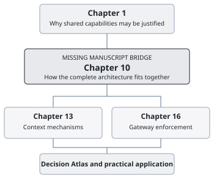
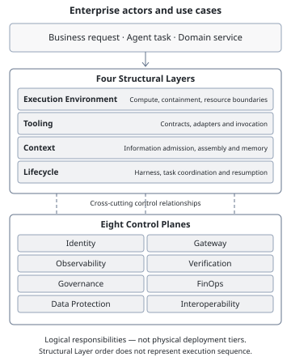
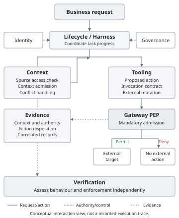
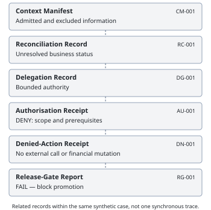

# Chapter 10 vs Chapter 41 — Acquisition Sample Selection

## Executive recommendation

**Write Chapter 10 — The Canonical Fabric Architecture next.**

This is a refinement of the previous recommendation to prioritise Chapter 41.

Chapter 41 remains the stronger demonstration of procedural writing and practical business-case development. However, when the selection is narrowed to these two chapters and the primary objective becomes confidence in the **coherence of the complete book**, Chapter 10 offers greater immediate acquisition value.

The distinction is fundamental.

Chapter 41 demonstrates whether the reader can execute one of the book's professional procedures.

Chapter 10 demonstrates whether the book's central architectural proposition works as a coherent system.

The existing acquisition samples establish that the author can explain why shared investment matters, how Context works and how the Gateway enforces consequential decisions.

What they do not yet establish is how those elements connect to the complete architecture.

For a book entitled *The Enterprise AI Agent Fabric*, that is the more consequential remaining evidence gap.

---

# 1. What the existing samples demonstrate

The accepted acquisition samples already establish several complementary writing capabilities.

| Acquisition sample | Demonstrated capability | Remaining limitation |
|---|---|---|
| Chapter 1 — The Case for a Shared Fabric | Commercial reasoning, conceptual orientation, investment trade-offs and authorial judgement | Does not explain the complete architecture |
| Chapter 13 — Context | Mechanism-level technical writing, provenance, semantic uncertainty and information integrity | Demonstrates one Structural Layer |
| Chapter 16 — Gateway Control Plane | Authority, policy enforcement, failure conditions and evidence | Demonstrates one Control Plane |
| Six Decision Atlas specimens | Concise architectural recommendations, trade-offs and reusable professional artefacts | Does not demonstrate the full architectural system in operation |

The sample portfolio provides credible evidence of individual technical depth.

It also establishes the book's central intellectual proposition: architectural decisions should remain connected to accountability, enforcement, verification and evidence.

However, the reader still has to infer how these responsibilities operate together.

## 1.1 What is already proven

Within the scope of the accepted samples:

- The author can establish a commercially relevant enterprise problem.
- The author can explain difficult technical distinctions.
- The author can reason about architectural failure conditions.
- The author can connect decisions to operational consequences.
- The author can produce concise professional reference material.
- The book can use consistent terminology and connected synthetic examples across multiple chapters.

## 1.2 What remains unproven

| Missing manuscript evidence | Significance |
|---|---|
| Complete architecture walkthrough | Establishes whether the book's central model is understandable as a system |
| Cross-layer interaction | Demonstrates how individually sound mechanisms cooperate |
| Cross-plane responsibilities | Establishes whether enforcement, verification and ownership remain distinct |
| End-to-end request trajectory | Shows how a reader can follow a request through the architecture |
| Successful versus denied action paths | Demonstrates how the architecture supports legitimate delivery as well as prevention |
| Complete evidence relationships | Shows how decisions and operational records connect across boundaries |
| Procedural writing | Demonstrates that readers can execute professional playbooks independently |
| Sustained manuscript production | Establishes whether writing quality can be maintained across 58 chapters |

The first six gaps directly concern the architecture promised by the book's title.

Chapter 10 addresses them more comprehensively than Chapter 41.

Neither chapter alone can establish sustained delivery capability across the entire manuscript.

---

# 2. Direct comparison — Chapter 10 versus Chapter 41

## 2.1 Apress commissioning editor perspective

| Consideration | Chapter 10 — Canonical Fabric Architecture | Chapter 41 — Build the Business Case |
|---|---|---|
| Demonstrates the book's central proposition | Directly | Through investment application |
| Connects existing acquisition samples | Strongly connects Chapters 13 and 16 | Strongly extends Chapter 1 |
| Provides a new writing format | System-level architectural synthesis | Procedural practitioner playbook |
| Clarifies what the book actually proposes | Very strong | Moderate |
| Demonstrates practical reader usefulness | Strong | Very strong |
| Reduces uncertainty about whole-book coherence | Very strong | Moderate–strong |
| Reduces uncertainty about procedural writing | Limited | Very strong |
| Helps distinguish the book from other platform books | Through integrated architecture and evidence relationships | Through actionable investment and decision artefacts |

**Preferred chapter: Chapter 10.**

A commissioning editor needs to understand what the proposed Fabric is before determining whether its associated playbooks constitute a sufficiently valuable professional reference.

Without Chapter 10, the editor has a strong commercial introduction and two detailed technical components, but not the authoritative architectural bridge between them.

## 2.2 Technical reviewer perspective

| Review question | Chapter 10 | Chapter 41 |
|---|---|---|
| Are architectural responsibilities consistently assigned? | Directly addressed | Indirectly addressed |
| Do the Structural Layers cooperate coherently? | Directly addressed | Not demonstrated |
| Are policy authority and runtime enforcement distinct? | Directly addressed | Limited |
| Can the reader trace a consequential action? | Directly addressed | Not demonstrated |
| Are investment assumptions defensible? | Limited | Directly addressed |
| Are operational responsibilities included in investment decisions? | Moderate | Strong |

**Preferred chapter: Chapter 10.**

The technical reviewer will want to determine whether Context, Tooling, Lifecycle and Gateway responsibilities form a coherent architecture rather than individually plausible but disconnected mechanisms.

Chapter 10 provides that evidence.

## 2.3 Enterprise architect perspective

Both chapters are valuable, but they solve different problems.

| Reader requirement | Stronger chapter |
|---|---|
| Explain the reference architecture to colleagues | Chapter 10 |
| Allocate architectural responsibilities | Chapter 10 |
| Understand integration and enforcement boundaries | Chapter 10 |
| Prepare an investment proposal | Chapter 41 |
| Compare financial and sourcing alternatives | Chapter 41 |
| Produce a defensible funding recommendation | Chapter 41 |

Chapter 41 may be more immediately useful to an architect preparing an investment submission.

However, Chapter 10 establishes the conceptual foundation necessary to understand what that investment might ultimately deliver.

**Preferred next acquisition sample: Chapter 10.**

## 2.4 CTO reader perspective

| CTO question | More appropriate chapter |
|---|---|
| Should we fund shared AI capabilities? | Chapter 41 |
| What capabilities would the investment create? | Chapter 10 |
| How are business risks controlled? | Chapter 10 |
| Who owns the architecture's responsibilities? | Chapter 10 |
| How much will the investment cost? | Chapter 41 |
| How should benefits be measured? | Chapter 41 |
| Does the proposed architecture make organisational sense? | Chapter 10 |

For a CTO focused on an imminent funding decision, Chapter 41 would provide greater immediate practical value.

For an acquisition portfolio intended to establish confidence in the book as a complete enterprise architecture reference, Chapter 10 has the broader foundational value.

---

# 3. Which chapter closes the most important confidence gaps?

**Incremental evidence added by each chapter**

| Evidence gap | Chapter 10 | Chapter 41 |
|---|---|---|
| Whole-system coherence | Direct | Limited |
| Cross-layer interaction | Direct | Not addressed |
| Control-plane boundaries | Direct | Indirect |
| End-to-end evidence flow | Direct | Investment scope |
| Architecture synthesis | Direct | Indirect |
| Procedural teaching | Limited | Direct |
| Financial appraisal | Limited | Direct |
| Professional artefact creation | Architecture | Business case |
| Demonstrated writing diversity | Additional synthesis | New format |

Chapter 41 wins when the principal question is whether the author can produce practical, procedural material.

Chapter 10 wins when the principal question is whether the complete book possesses a coherent architectural foundation.

For the current acquisition portfolio, the second question is more fundamental.

## 3.1 The missing architectural bridge

*Chapter 10 supplies the missing conceptual link between the book's commercial argument and its demonstrated technical mechanisms.*

This is the reason I would prioritise Chapter 10 ahead of Chapter 41.

---

# 4. Chapter 10 — Complete authoring package

## The Canonical Fabric Architecture

The authoring package follows the existing Development Blueprint, frozen chapter specification, Style Bible, Decision Atlas catalogue and Meridian evidence dossier.

It does not introduce new layers, planes, architectural concepts or canonical decisions.

## 4.1 Chapter specification

| Attribute | Existing requirement |
|---|---|
| Chapter | 10 |
| Part | III — Architecture |
| Title | The Canonical Fabric Architecture |
| Template | Architecture overview / E1 |
| Planned length | 8 pages |
| Narrative allocation | 5% |
| Maximum narrative | 150 words |
| Primary decisions | D-07 and D-18 |
| Required illustrations | Figures 10-1 and 10-2 |
| Required artefacts | Layer stack, ownership diagram and execution/ownership crosswalk |
| Reader outcome | Understand the four Structural Layers and eight Control Planes; trace a request and its evidence |
| Primary failure mode | Control ownership follows diagram boxes rather than architectural responsibilities |
| Principal anti-patterns | Tier proliferation and one excessively complicated architecture diagram |

The Development Blueprint specifies three logical paths, evidence joins, enforcement boundaries and worked read and write trajectories.

### Source authorities

- [Development Blueprint — Chapter 10](https://github.com/smartnimbus/enterprise-ai-platform-engineering-book/blob/cc728dbec56190276eb3f25b5f10729c9959ab95/editorial/outlines/Enterprise_AI_Agent_Fabric_Development_Blueprint.md)
- [Style Bible v1.2](https://github.com/smartnimbus/enterprise-ai-platform-engineering-book/blob/cc728dbec56190276eb3f25b5f10729c9959ab95/editorial/style/style-v1.2.md)
- [Frozen 58-chapter specification](https://github.com/smartnimbus/enterprise-ai-platform-engineering-book/blob/cc728dbec56190276eb3f25b5f10729c9959ab95/publishing/apress/v2/FROZEN-TOC-58.csv)
- [Decision catalogue](https://github.com/smartnimbus/enterprise-ai-platform-engineering-book/blob/cc728dbec56190276eb3f25b5f10729c9959ab95/decisions/catalogue/Enterprise_AI_Agent_Fabric_Decision_Catalogue.csv)
- [Meridian Evidence Fixture v1.0](https://github.com/smartnimbus/enterprise-ai-platform-engineering-book/blob/cc728dbec56190276eb3f25b5f10729c9959ab95/meridian/fixture/Meridian_Evidence_Fixture_v1.0.md)

The existing Chapter 10 authoring contract remains marked as proposed rather than ratified. This package respects its declared scope and does not claim otherwise.

---

# 5. Chapter mission

## 5.1 Central mission

Enable the reader to understand the complete Enterprise AI Agent Fabric as a coherent arrangement of architectural responsibilities, rather than a collection of independently described components.

The reader should understand:

- Where agent capabilities execute.
- How tools and contextual information become available.
- How task execution is coordinated.
- Where authority and policy decisions take effect.
- How consequential actions are controlled.
- How evidence is produced and connected.
- How independent verification influences continuing operation.

Chapter 10 must establish the navigation model for the technical chapters that follow.

It should not attempt to reproduce all twelve subsequent architecture deep dives.

## 5.2 Central teaching argument

> The architecture of an enterprise agent system is defined by the responsibilities that must remain connected, not by the number of technologies it contains.

This is a proposed chapter-level teaching argument, not a new Atlas default.

## 5.3 Commercial purpose

Chapter 1 explains when shared capabilities may be justified.

Chapter 10 explains what architectural responsibilities must be established once the enterprise starts designing those capabilities.

The transition must be clear without implying that every enterprise needs all responsibilities implemented as dedicated shared services.

---

# 6. Reader outcomes

After completing Chapter 10, a reader should be able to perform the following activities.

| Reader capability | Observable outcome |
|---|---|
| Explain the canonical architecture | Describe the purpose of each Structural Layer and Control Plane |
| Distinguish architecture from deployment | Explain why twelve logical responsibilities do not require twelve separate products |
| Trace a request | Follow the interaction between execution, tooling, context and lifecycle responsibilities |
| Trace delegated authority | Identify where identity, delegation and action admission become relevant |
| Locate enforcement boundaries | Identify where consequential external actions must be controlled |
| Interpret contextual disagreement | Explain why authorised retrieval does not establish business truth |
| Interpret verification outcomes | Explain why successful action denial does not establish correct agent behaviour |
| Connect evidence | Locate the records supporting the architectural conclusion |
| Allocate responsibilities | Identify which part of the architecture owns each obligation |
| Navigate the rest of the book | Identify which subsequent chapter provides the detailed mechanism |

The strongest reader outcome would be the ability to explain the complete reference architecture to another experienced architect after reading this chapter alone.

---

# 7. Canonical architecture walkthrough

Chapter 10 should introduce the architecture through three complementary questions:

1. Where does the work take place?
2. Which responsibilities control that work?
3. How can the organisation establish what happened?

These questions provide the pedagogical structure for the architecture walkthrough.

## 7.1 Four Structural Layers

The existing concept-ownership specification assigns the following responsibilities.

| Structural Layer | Canonical responsibility | Detailed chapter |
|---|---|---|
| Execution Environment | Workers, compute, sandboxing, resource limits, filesystem and network constraints, teardown and resumption infrastructure | Chapter 11 |
| Tooling | Tool catalogue, schema binding, protocol adapters, invocation contracts, idempotency and result normalisation | Chapter 12 |
| Context | Intake, access-filtered retrieval, context assembly, canonical identities, semantic reconciliation, memory and provenance | Chapter 13 |
| Lifecycle | Harness, task loop, step budgets, checkpoints, coordination, interruption, escalation and resumption | Chapter 14 |

The chapter must explain the difference between these responsibilities without suggesting that every implementation requires four separately deployed infrastructure tiers.

## 7.2 Eight Control Planes

| Control Plane | Canonical responsibility | Detailed chapter |
|---|---|---|
| Identity | Human, agent, tenant and delegated identities; claims and attenuation | Chapter 15 |
| Gateway | Admission, routing policy, protocol boundaries, egress and consequential-action enforcement | Chapter 16 |
| Observability | Telemetry, correlation, trajectories, metrics and incident signals | Chapter 17 |
| Verification | Behavioural assertions, integrity checks and runtime or release verification | Chapter 18 |
| Governance | Autonomy, accepted risk, approval authority, ownership and exceptions | Chapter 19 |
| FinOps | Budgets, allocation, unit economics, pricing assumptions and financial exceptions | Chapter 20 |
| Data Protection | Classification, consent, residency, retention, deletion and encryption requirements | Chapter 21 |
| Interoperability | Protocol and version contracts, compatibility and event semantics | Chapter 22 |

A Control Plane represents a logical responsibility. It does not necessarily correspond to a dedicated microservice, network component or organisational team.

## 7.3 The most important architectural distinctions

The manuscript should explicitly distinguish the following responsibilities.

| Distinction | What the reader must understand |
|---|---|
| Identity versus Gateway | Establishing identity and delegated authority is different from enforcing an action decision |
| Context versus Data Protection | Context assembly does not create permission to disregard data protection requirements |
| Context versus business truth | Authorised observations may remain contradictory |
| Lifecycle versus Execution Environment | Coordinating task progress is different from providing its runtime infrastructure |
| Governance versus enforcement | Establishing policy authority is different from implementing runtime admission |
| Observability versus Verification | Recording behaviour is different from establishing that the behaviour is acceptable |
| FinOps versus runtime resource control | Financial allocation rules differ from resource metering and execution limits |
| Interoperability versus Tooling | Defining compatibility contracts differs from implementing individual invocation adapters |

These distinctions are more important than introducing another architectural taxonomy.

They establish why the canonical model separates these responsibilities.

---

# 8. Required architecture illustrations

The Development Blueprint requires Figures 10-1 and 10-2.

I recommend retaining exactly these two primary figures rather than producing a single enormous architecture illustration.

The diagrams below are proposed teaching layouts for the manuscript, not newly approved architectural specifications.

## Figure 10-1 — Canonical Fabric responsibility model

*Proposed Figure 10-1. The four Structural Layers and eight cross-cutting Control Planes, presented as a logical responsibility model.*

### Figure requirements

| Requirement | Expected treatment |
|---|---|
| Completeness | Exactly four Structural Layers and eight Control Planes |
| Semantics | Distinguish structural responsibilities from cross-cutting controls |
| Deployment independence | Do not imply twelve independently deployed products |
| Readability | Understandable at normal printed page size |
| Directionality | Do not imply that tasks execute sequentially through the displayed layer order |
| Terminology | Use the existing canonical names |
| Accessibility | Caption, meaningful alternative text and greyscale legibility |

**Proposed caption:**

*Figure 10-1. The canonical Enterprise AI Agent Fabric separates the responsibilities that enable agent execution from the cross-cutting responsibilities that govern, constrain, observe and verify it. These logical boundaries do not prescribe a particular physical deployment topology.*

---

## Figure 10-2 — Request, authority and evidence relationships

This figure should explain how the architecture's responsibilities cooperate through a consequential task.

*Proposed Figure 10-2. Selected request, control and evidence relationships. The permitted-action branch illustrates an architectural possibility, not an observed Meridian refund outcome.*

### Figure 10-2 must establish

- The Harness coordinates task progress.
- Context admission respects applicable access boundaries.
- An action proposal is not equivalent to permission.
- Mutable external actions require mandatory enforcement.
- Denied actions do not reach external targets.
- Evidence is associated with the relevant request and decisions.
- Verification assesses behaviour independently of whether enforcement succeeded.

The author should preserve these semantic distinctions in the final illustration.

This proposed interaction view intentionally does not repeat all twelve responsibilities from Figure 10-1. It illustrates selected interactions rather than attempting to show every possible architecture dependency.

---

# 9. Manuscript structure

The chapter must follow the established E1 architecture-overview format.

## 9.1 Opening hook — a consequential action without traceable responsibility

**Target:** 80–120 words, within the existing 150-word maximum.

The opening should use the Development Blueprint's prescribed failure:

> A mutable action cannot be attributed to one policy decision across two pilots.

The purpose is to establish why individual component descriptions are insufficient.

The reader must recognise that an enterprise needs to connect requests, authority, controls and resulting evidence across multiple architectural boundaries.

Do not create a new recorded Meridian transaction or suggest that the established £125 refund was executed.

## 9.2 What this chapter decides

Suggested framing sentence:

> This chapter establishes the canonical allocation of agent execution and control responsibilities, and explains how a request, its authority and its evidence can be traced across those boundaries.

## 9.3 The mechanism

The majority of the chapter should explain the architecture through:

| Section | Teaching responsibility |
|---|---|
| Architectural responsibilities | Establish what the reference architecture represents |
| Four Structural Layers | Explain the work that each layer owns |
| Eight Control Planes | Explain the control responsibilities |
| Logical relationships | Explain how task execution, authority and evidence interact |
| Worked read trajectory | Demonstrate legitimate, bounded information use |
| Worked mutable-action trajectory | Demonstrate the proposed action and denial |
| Evidence joins | Connect the relevant synthetic records |
| Responsibility allocation | Establish which architectural boundary owns each obligation |

The walkthrough must be more than twelve component descriptions.

It should explain the architectural relationships that make the complete model useful.

## 9.4 Failure modes

Concentrate on cross-boundary failures, particularly:

| Failure | Consequence |
|---|---|
| Identity treated as business approval | An authenticated actor acquires inappropriate action authority |
| Context admission treated as semantic correctness | Conflicting information is converted into apparent truth |
| Gateway treated as the sole security dependency | Alternate external routes may bypass enforcement |
| Telemetry treated as proof | Recorded activity is mistaken for verified effectiveness |
| Successful denial treated as correct agent behaviour | An inappropriate agent may be promoted despite enforcement |
| Responsibility inferred from physical deployment | Important control obligations have no accountable owner |

## 9.5 Anti-patterns

The chapter should include the two explicit Blueprint anti-patterns:

**Tier proliferation.** Creating additional architectural tiers whenever a new control requirement appears, even when an existing responsibility already owns it.

**The gigantic architecture diagram.** Attempting to communicate every runtime interaction, control dependency, data flow, operational responsibility and deployment detail in one illustration.

A further proposed teaching anti-pattern is the assumption that each logical Control Plane requires a dedicated platform product.

## 9.6 Mandatory closing blocks

The manuscript should end with the established sequence:

- Decisions to make.
- Defaults.
- Artefacts to produce.
- See also.

The decisions and defaults should remain matched and traceable to the existing Atlas.

---

# 10. End-to-end architecture walkthrough

This is the decisive section of Chapter 10.

It must demonstrate that the existing technical samples are parts of one coherent architecture.

## 10.1 Use the existing Meridian case

The original request concerns a customer refund of **GBP 125.00**.

The request authorises review, retrieval, reconciliation, preparation and an approval request. It explicitly prohibits sending money without the appropriate authorisation.

The manuscript should preserve the established distinction between:

- A request to investigate and prepare.
- A proposed mutable action.
- Permission to execute the action.
- Actual execution.
- Verification of agent behaviour.

These are not interchangeable outcomes.

## 10.2 Worked read trajectory

| Interaction | Architectural responsibility | Recorded synthetic outcome |
|---|---|---|
| Request accepted | Lifecycle and applicable admission responsibilities | Read/prepare request allowed |
| Candidate insurance item encountered | Context and Data Protection responsibilities | Incorrectly indexed cross-tenant item excluded |
| Retail Record A retrieved | Context retrieval and source access control | Allowed |
| Retail Record B retrieved | Context retrieval and source access control | Allowed |
| Product identity and effective time compared | Context semantic reconciliation | Records disagree |
| Conflict escalated | Context, Lifecycle and domain ownership | Status remains unresolved |

The crucial point is that the permitted retrieval succeeds without establishing that either conflicting status is authoritative.

The read trajectory demonstrates bounded information access and honest treatment of uncertainty.

It does not demonstrate a successful eligibility determination, completed business approval or refund.

## 10.3 Worked mutable-action trajectory

| Interaction | Architectural responsibility | Recorded synthetic outcome |
|---|---|---|
| Authority delegated | Identity | Effective permission restricted to permitted scopes |
| Refund action proposed | Lifecycle and Tooling | `refund.issue` proposed |
| Action evaluated | Gateway | Required execution scope absent |
| Context prerequisite checked | Gateway using relevant evidence | Product status unresolved |
| Execution approval checked | Applicable policy and enforcement responsibilities | Approval absent |
| Action denied | Gateway enforcement | No external call |
| Alternate route tested | Network and egress enforcement | Simulated direct-route bypass blocked |
| Release candidate evaluated | Verification | Behavioural assertion fails |
| Promotion withheld | Release decision authority | Candidate not deployed |

## 10.4 The essential architectural lesson

| Gateway enforcement | Agent behaviour |
|---|---|
| **Denial effective** | **Verification failed** |
| The proposed external action did not occur in the synthetic example. | The candidate selected an inappropriate action despite unresolved information. |

**A successful control denial does not establish correct agent behaviour.**

*Meridian synthetic evidence. Not a claim of an independently tested production system.*

This distinction should be one of Chapter 10's strongest teaching moments.

It demonstrates why Gateway and Verification are different architectural responsibilities.

It also establishes a concrete connection between the Chapter 13 Context sample and the Chapter 16 Gateway sample.

## 10.5 Successful write path — how to teach it without changing the fixture

The Blueprint requires a write trajectory.

The existing Meridian fixture demonstrates a denied mutable action, not a completed refund.

The chapter can therefore explain a permitted write as a **separate conditional architecture example**:

A mutable action could proceed only when its current authority, applicable policy, contextual prerequisites and required approvals were established and an effective enforcement mechanism admitted the action.

The chapter must not add an `ALLOW` receipt, successful refund, production mutation or invented evidence identifier to the existing Meridian case.

That distinction preserves the difference between a designed architectural path and a recorded synthetic outcome.

---

# 11. Evidence relationships

The six existing evidence artefacts provide the strongest connection to the book's differentiation.

## 11.1 Evidence chain

| Evidence artefact | Identifier | Responsibility demonstrated |
|---|---|---|
| Context Manifest | `MF-EVD-CM-001` | Information admission and provenance |
| Reconciliation Record | `MF-EVD-RC-001` | Explicit semantic disagreement |
| Delegation Record | `MF-EVD-DG-001` | Authority attenuation |
| Authorisation Receipt | `MF-EVD-AU-001` | Action admission decision |
| Denied-Action Receipt | `MF-EVD-DN-001` | Enforcement outcome |
| Release-Gate Report | `MF-EVD-RG-001` | Independent behavioural verification and blocked promotion |

*Teaching view of the six related synthetic evidence records. Vertical ordering is explanatory; the actual record links and event chronology remain authoritative.*

This relationship demonstrates decision-to-evidence engineering across architectural boundaries.

It also establishes why an isolated log entry, authorisation receipt or evaluation result is insufficient to explain the complete outcome.

The manuscript must respect the actual chronology and avoid collapsing separate retrieval, action and release-test events into a single continuous execution.

## 11.2 Evidence interpretation boundaries

| Record | Supports | Does not establish |
|---|---|---|
| Context Manifest | Which information was admitted or excluded in the fixture | That admitted information is true |
| Reconciliation Record | The existence of unresolved disagreement | That either source is authoritative |
| Delegation Record | The specified synthetic authority chain | A real signed production credential |
| Authorisation Receipt | The recorded denial decision | Successful production enforcement |
| Denied-Action Receipt | No external call and zero financial mutations in the fixture | Universal proof of non-bypassability |
| Release-Gate Report | The failed assertion and blocked promotion | Correct behaviour by the failed candidate |

This evidence discipline should be visible throughout the chapter.

It is a stronger differentiator than simply presenting an architectural diagram.

---

# 12. Decision Atlas integration

Chapter 10 has two primary associated decisions.

Their exact defaults must be preserved.

## D-07 — Select execution isolation

**Frozen default:**

> Default to ephemeral, policy-constrained workers for execution with side effects or untrusted code.

**Required Chapter 10 treatment**

Explain why execution isolation is a distinct structural responsibility and why the appropriate containment level depends on the nature of the workload.

Detailed worker isolation, teardown, reuse and resource limits remain the responsibility of Chapter 11.

## D-18 — Prove Gateway non-bypassability

**Frozen default:**

> Default to mandatory PEP checks on mutable external actions, enforced by credentials, routing policy and egress controls.

**Required Chapter 10 treatment**

Explain why a policy decision or Gateway component is insufficient unless the consequential action is subject to effective enforcement.

A diagram showing a Gateway between an agent and an external system does not independently establish that alternate paths are unavailable.

Detailed enforcement and bypass testing remain the responsibility of Chapter 16.

## Required reader artefacts

| Decision | Existing resulting artefact |
|---|---|
| D-07 | `execution-isolation-profile.yaml` |
| D-18 | `gateway-bypass-proof.md` |

Chapter 10 introduces the need for these records and directs the reader towards their detailed treatment. It should not claim that the frozen Meridian case supplies a completed production isolation profile or actual non-bypassability proof.

---

# 13. Execution and ownership crosswalk

The existing Blueprint requires an execution/ownership crosswalk.

The chapter should use a concise table to connect architectural responsibilities to their obligations.

| Architectural responsibility | Owns | Must not be assumed to own |
|---|---|---|
| Execution Environment | Runtime infrastructure, containment and execution constraints | Business action approval |
| Tooling | Invocation contracts, adapters and result normalisation | Authority to override action policy |
| Context | Information assembly, retrieval implementation and reconciliation mechanisms | Unilateral business truth or access exceptions |
| Lifecycle | Task coordination, checkpoints, interruption and resumption | Unrestricted privilege |
| Identity | Claims and delegated authority relationships | Business approval or Gateway enforcement |
| Gateway | Runtime admission and mandatory side-effect enforcement | Domain data mastership |
| Observability | Collection and correlation of telemetry | Verification acceptance |
| Verification | Assertions, evaluations and verification outcomes | Runtime business execution authority |
| Governance | Accepted risk, policy authority, ownership and approval requirements | Tool invocation or token issuance |
| FinOps | Financial allocation, budgets and economic requirements | Network routing or direct resource metering |
| Data Protection | Data handling, retention and protection requirements | Resolution of business semantic disagreement |
| Interoperability | Compatibility, protocol and version responsibilities | Business entity mastership |

The crosswalk must distinguish responsibility ownership from implementation placement.

In a real enterprise, several responsibilities may be implemented through one technology or assigned across several teams. That implementation choice must not obscure the individual obligations.

---

# 14. Differentiation opportunities

Chapter 10 must not compete with other architecture books merely by presenting a larger or more elaborate reference architecture.

Its strongest differentiation lies in how the architecture is explained.

| Opportunity | Required treatment |
|---|---|
| Responsibility-oriented architecture | Organise the explanation around obligations rather than products |
| Decision-to-evidence relationships | Connect an architectural choice to the mechanism and its resulting records |
| Explicit authority boundaries | Separate identity, policy authority and enforcement |
| Independent verification | Demonstrate why blocked actions can still reveal unacceptable agent behaviour |
| Connected Meridian evidence | Use the same case as Chapters 13 and 16 |
| Deployment neutrality | Show that the architecture is not a mandatory technology stack |
| Negative outcomes | Teach denial, unresolved information and blocked release as meaningful results |
| Reader navigation | Establish the relationship between the architecture overview and subsequent mechanism chapters |

The most commercially important opportunity is to demonstrate the architecture through a meaningful business request instead of introducing twelve responsibilities in isolation.

---

# 15. Overlap risks

Chapter 10 must remain an architecture synthesis chapter.

Its role is to establish the complete map, not take ownership of the individual architectural mechanisms.

| Existing chapter | Responsibility retained there | Appropriate Chapter 10 treatment |
|---|---|---|
| Chapter 1 | Shared investment justification | Brief transition from investment to design |
| Chapter 11 | Execution isolation and resource mechanisms | Establish the runtime boundary |
| Chapter 12 | Tool contracts and invocation mechanisms | Explain the proposed action interface |
| Chapter 13 | Context admission, memory and semantic reconciliation | Show Context's interaction with other responsibilities |
| Chapter 14 | Harness, state, checkpoints and resumption | Explain task coordination at overview level |
| Chapter 15 | Identity and delegation mechanisms | Show the authority relationship |
| Chapter 16 | Gateway admission and bypass controls | Show where mandatory enforcement occurs |
| Chapter 17 | Telemetry and evidence correlation mechanisms | Explain the evidence relationship |
| Chapter 18 | Evaluations and release verification | Show the independent behavioural conclusion |
| Chapters 19–22 | Their respective control responsibilities | Establish purpose and architectural boundaries |
| Chapter 23 | Complete Decision Atlas | Introduce relevant existing defaults |
| Chapter 41 | Executable investment appraisal | Do not reproduce the business-case procedure |
| Chapter 42 | Reference architecture design playbook | Explain the model without teaching the complete design procedure |

## The most important editorial boundary

Chapter 10 should explain **how the architecture fits together**.

Chapter 13 and Chapter 16 explain **how particular mechanisms work**.

This separation is essential to proving that the complete book can scale without excessive duplication.

---

# 16. Proposed manuscript allocation

The existing chapter specification allocates eight pages, with a 5% narrative allocation and an absolute 150-word narrative maximum.

| Section | Proposed working words |
|---|---:|
| Opening failure vignette | 80–120 |
| Architecture purpose and framing | 100–150 |
| Structural Layers | 250–350 |
| Control Planes | 350–450 |
| Architectural relationships | 200–300 |
| Read and mutable-action trajectories | 400–550 |
| Evidence relationships | 150–250 |
| Failure modes and anti-patterns | 150–200 |
| Closing blocks | 120–180 |
| **Indicative total** | **1,800–2,550** |

These are proposed authoring allocations, not an approved replacement for the existing page budget.

Two illustrations and the execution/ownership crosswalk consume significant typeset space. The manuscript must therefore prioritise architectural relationships over long definitions and repeated examples.

Final length should be established through actual typesetting rather than word count alone.

---

# 17. Acquisition success criteria

## 17.1 What Apress should be able to establish

| Acquisition question | Successful Chapter 10 evidence |
|---|---|
| What exactly is the proposed Fabric? | A clear, bounded architecture explanation |
| Do the existing samples belong to one coherent book? | Explicit relationships between Context, Gateway and the remaining responsibilities |
| Does the architecture have a distinctive teaching method? | Decision-to-evidence engineering demonstrated through an integrated request |
| Can a reader understand the system without reading all subsequent chapters? | A self-contained overview |
| Does the author exercise architectural judgement? | Logical responsibilities are not confused with physical deployment |
| Are technical claims credible? | Synthetic and hypothetical evidence classifications remain explicit |
| Will later chapters provide additional value? | Overview avoids duplicating detailed mechanism explanations |

## 17.2 What would create acquisition enthusiasm

The strongest possible Chapter 10 would enable the commissioning editor to move directly from the commercial argument in Chapter 1 into the complete architecture and then into the technical mechanisms of Chapters 13 and 16.

The samples would read as interconnected parts of one book.

That is more persuasive than presenting four individually strong but structurally disconnected technical chapters.

---

# 18. Technical and developmental editor criteria

These criteria describe what the manuscript must demonstrate, rather than introducing another review system.

| Editorial question | Acceptable manuscript outcome |
|---|---|
| Are all architectural responsibilities identifiable? | Exactly four Structural Layers and eight Control Planes |
| Does the architecture imply unnecessary deployment tiers? | No; logical and physical responsibilities are clearly distinguished |
| Does the request walkthrough preserve authority boundaries? | Identity, approval and enforcement remain distinct |
| Is the read trajectory correctly interpreted? | Authorised retrieval does not resolve the business conflict |
| Is the mutable action represented correctly? | Denied, with no external call or financial mutation |
| Is the simulated bypass outcome described accurately? | No claim of actual production testing |
| Is verification independent of Gateway enforcement? | Successful denial and failed behaviour are clearly distinguished |
| Are the figures understandable? | Complementary, readable and semantically accurate |
| Is the chapter sufficiently differentiated? | Evidence relationships are central to the explanation |
| Does it preserve the existing samples? | No reinterpretation of Chapter 13 or 16 mechanisms |
| Does it prepare the reader for the remaining book? | Clear responsibility and chapter navigation |

## Immediate editorial rejection risks

The following mistakes would substantially weaken this particular sample:

- Introducing a ninth Control Plane or fifth Structural Layer.
- Presenting the canonical responsibilities as mandatory physical services.
- Producing diagrams without an explanatory architectural argument.
- Claiming the Meridian refund was successfully executed.
- Treating successful enforcement as proof of correct agent behaviour.
- Inventing evidence to make the architecture walkthrough appear complete.
- Reproducing large portions of Chapters 13 and 16.
- Describing every architecture responsibility but failing to show how they cooperate.

The last mistake is particularly damaging.

A chapter entitled *The Canonical Fabric Architecture* must explain the whole system, not merely provide a catalogue of its components.

---

# 19. What Chapter 10 would demonstrate to each audience

| Audience | Additional confidence established |
|---|---|
| Apress commissioning editor | The commercial premise, architecture and technical samples form a coherent professional book |
| Technical reviewer | The major responsibility boundaries can be examined through an integrated request and evidence relationship |
| Enterprise architect | The complete architecture can be explained, communicated and applied as a logical reference |
| CTO | The proposed architecture provides identifiable capabilities, control responsibilities and accountability boundaries |
| Developmental editor | The author can synthesise complex mechanisms without reproducing all detailed chapter content |

Chapter 41 would still be necessary to demonstrate procedural authoring breadth.

But Chapter 10 provides the more fundamental architectural evidence currently missing from the acquisition portfolio.

---

# 20. Final acquisition sample recommendation

**Recommended four-chapter sample portfolio**

| Sample | Contribution |
|---|---|
| Chapter 1 — Accepted draft | Why the enterprise decision matters |
| Chapter 10 — Selected next manuscript | How the complete architecture works together |
| Chapter 13 — Accepted draft | How contextual integrity is maintained |
| Chapter 16 — Accepted draft | How consequential actions are controlled |
| Decision Atlas — Six existing specimens | How architectural decisions become reusable |

## Final decision

**Chapter 10 — The Canonical Fabric Architecture provides the highest incremental acquisition value at this point.**

Chapter 41 is stronger for demonstrating a genuinely different writing format. If the only objective were to demonstrate procedural authoring scalability, I would retain the earlier Chapter 41 recommendation.

However, the current acquisition portfolio has a more consequential missing link: the manuscript that explains how the book's complete architecture fits together.

Chapter 10 closes that gap.

It connects the commercial argument of Chapter 1 to the technical mechanisms of Chapters 13 and 16, demonstrates the relationship between the Structural Layers and Control Planes, and gives the reader an integrated experience of decision-to-evidence engineering.

**Chapter 10 proves the book's architectural coherence. Chapter 41 proves its procedural breadth. Architectural coherence is the more valuable next demonstration.**

The authoring package above is ready to support manuscript creation. The proposed figure layouts, teaching decomposition and word allocations remain authoring choices requiring final editorial acceptance. No additional architecture, recorded Meridian outcomes or canonical decisions have been introduced, and no claim is made that completing one further chapter establishes delivery capability across all 58 chapters.

The next substantive output should be the complete acquisition-quality Chapter 10 manuscript.
