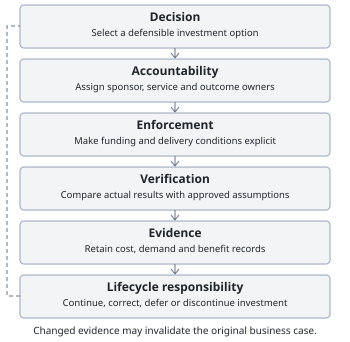
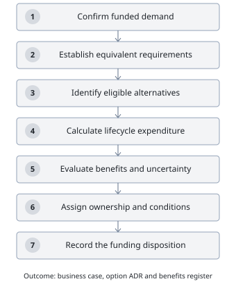

# Manuscript Scalability — Next Chapter Selection and Authoring Package

## Executive recommendation

**Write Chapter 41 — P1: Build the Business Case next.**

Chapter 14 would strengthen the technical architecture samples. Chapter 10 would demonstrate architectural integration. Chapter 23 would strengthen the signature reference asset.

However, Chapter 41 would demonstrate something the existing three acquisition manuscripts have not yet established:

**The author's ability to turn architectural knowledge into an executable professional procedure that produces a decision another person can use.**

That is a particularly important missing capability for a 58-chapter book that promises not only architecture explanations, but also investment decisions, lifecycle guidance, operational responsibilities and practitioner playbooks.

Chapter 41 should become the fourth substantive manuscript sample.

---

# 1. What the existing manuscript samples demonstrate

The current three-chapter sample set establishes credible preliminary writing capability across three chapter types.

| Manuscript | Chapter type | Capability demonstrated |
|---|---|---|
| Chapter 1 — The Case for a Shared Fabric | Conceptual orientation | Establishing a commercial argument, explaining trade-offs, engaging readers and introducing the decision method |
| Chapter 13 — Context | Structural architecture | Explaining complex technical mechanisms, information integrity, provenance and failure conditions |
| Chapter 16 — Gateway Control Plane | Control-plane architecture | Explaining authority, enforcement boundaries, technical controls and verification evidence |

These chapters demonstrate three distinct writing capabilities, but Chapters 13 and 16 remain closely related in their professional reference style.

Chapter 1 introduces greater narrative and analytical variety. Its investment example also demonstrates the ability to connect technical considerations to commercial decisions.

However, explaining a decision and teaching somebody to execute that decision are different authoring capabilities.

## 1.1 Is the sample set sufficient?

**For demonstrating initial technical writing capability: yes.**

**For demonstrating that the author can sustain all eight parts of a 58-chapter professional manuscript: no.**

The distinction is not about whether the existing chapters are good enough. Their accepted acquisition status remains unchanged.

It concerns the breadth of writing capability they demonstrate.

**Demonstrated authoring coverage**

| Part | Evidence |
|---|---|
| I — Orientation | Chapter 1 |
| II — Strategic choices | Not yet demonstrated in a complete chapter |
| III — Architecture | Chapters 13 and 16 |
| IV — Decision Atlas | Six representative standalone specimens |
| V — Lifecycle | Not yet demonstrated in a complete chapter |
| VI — Operations | Not yet demonstrated in a complete chapter |
| VII — Practitioner playbooks | Not yet demonstrated |
| VIII — Reference | Not yet demonstrated in a complete chapter |

*Coverage of demonstrated writing formats, not a manuscript quality or completion score.*

## 1.2 Evidence that remains missing

| Authoring capability | Why it matters to Apress |
|---|---|
| Procedural writing | Establishes whether readers can execute an activity without author assistance |
| Multi-decision synthesis | Demonstrates that multiple Atlas decisions can contribute to one coherent outcome |
| Financial and commercial reasoning | Establishes credibility with CTOs and technology investment decision-makers |
| Completed professional deliverables | Demonstrates tangible reader value rather than conceptual understanding alone |
| Cross-chapter continuity without duplication | Shows that a large manuscript can retain coherence while each chapter has a distinct purpose |
| Sustained production effort | Establishes whether manuscript quality is repeatable within a realistic delivery commitment |

Chapter 41 directly addresses the first five areas. Recording actual authoring and revision effort while completing it can also provide preliminary evidence for the sixth.

No single additional chapter can prove that all 58 chapters will be completed successfully. The objective is to select the chapter that removes the greatest amount of uncertainty.

---

# 2. Comparison of the five candidate chapters

The selection is grounded in the existing Development Blueprint, chapter contracts, frozen chapter allocations and Style Bible. I have used their current specifications rather than inventing new chapter responsibilities.

| Candidate | Existing chapter responsibility | Additional authoring capability demonstrated | Acquisition value for the current sample set |
|---|---|---|---|
| Chapter 2 — Agent Capability, Autonomy and Risk | Classify agent capabilities and permitted actions | Conceptual classification and explanatory teaching | Useful, but remains within the orientation format already demonstrated by Chapter 1 |
| Chapter 10 — The Canonical Fabric Architecture | Explain the complete reference architecture and trace requests and evidence | System-level technical synthesis and diagram-led explanation | Strong, but extends the architecture-oriented capability already demonstrated |
| Chapter 14 — Lifecycle | Explain orchestration, interruption, resumption and bounded task execution | State-machine reasoning, recovery semantics and technical depth | Excellent technical evidence, but another Structural Layer chapter |
| Chapter 23 — The Fabric Decision Atlas | Present all thirty decision pages | Consistency across a large, constrained reference format | Strong signature-asset evidence, but six specimens already provide preliminary proof of this format |
| **Chapter 41 — P1: Build the Business Case** | Execute sourcing and financial appraisal to reach a funding decision | Procedural writing, financial reasoning, decision synthesis and practical deliverable creation | **Greatest incremental authoring evidence** |

The crucial criterion is **incremental acquisition value**, rather than the importance of the chapter to the architecture.

Chapter 14 may be more technically demanding. Chapter 23 may contain more pages. Chapter 10 may be more central to understanding the complete Fabric.

But Chapter 41 exposes whether the author can teach the reader to *do something* with the architecture.

## 2.1 Why Chapter 41 is the strongest selection

The relationship between Chapters 1 and 41 provides an unusually valuable demonstration of whole-book coherence.

**Chapter 1 — Existing orientation sample**

**Establish whether a repeated enterprise problem justifies shared investment.**

Introduces the economic argument, accountability considerations and Fabric Opportunity Brief.

↓

**Decision Atlas — Existing signature asset**

**Provide the defaults, trade-offs and deviation conditions.**

D-01, D-02, D-03 and D-26 inform the subsequent appraisal.

↓

**Chapter 41 — Recommended additional sample**

**Execute an investment appraisal and obtain a defensible funding disposition.**

Produces a completed business case, option decision record and benefits register.

This demonstrates that the book's different parts are not simply repeating the same recommendations in different formats.

They perform different functions for the reader:

- Chapter 1 establishes why the decision matters.
- The Atlas establishes the recommended starting positions.
- Chapter 41 teaches how to execute the appraisal and produce its outcome.

A successful Chapter 41 would provide particularly compelling evidence that the 58-chapter structure can operate as an integrated professional reference.

---

# 3. Chapter 41 — Authoring Package

## P1: Build the Business Case

This package uses the existing chapter specifications. It does not create a replacement chapter contract or change the Decision Atlas.

### 3.1 Authoritative chapter requirements

| Attribute | Existing specification |
|---|---|
| Chapter | 41 |
| Part | VII — Practitioner Playbooks |
| Playbook | P1: Build the Business Case |
| Template | F2 / F5 |
| Planned length | 7 pages |
| Narrative allocation | 25% |
| Narrative allowance | 150–300 words |
| Primary reader outcome | Execute sourcing and financial appraisal to obtain a funding disposition |
| Mechanism | Seven-step appraisal |
| Associated decisions | D-01, D-02, D-03, D-26 |
| Required artefacts | Business case, option ADR, benefits register |
| Chapter references | Chapters 1, 5, 8 and 24 |
| Principal failure modes | Unsupported ROI and Fabric-first assumptions |

**Source materials:**

- [Development Blueprint — Chapter 41](https://github.com/smartnimbus/enterprise-ai-platform-engineering-book/blob/cc728dbec56190276eb3f25b5f10729c9959ab95/editorial/outlines/Enterprise_AI_Agent_Fabric_Development_Blueprint.md)
- [Frozen chapter specification](https://github.com/smartnimbus/enterprise-ai-platform-engineering-book/blob/cc728dbec56190276eb3f25b5f10729c9959ab95/publishing/apress/v2/FROZEN-TOC-58.csv)
- [Style Bible v1.2 — F2 and F5](https://github.com/smartnimbus/enterprise-ai-platform-engineering-book/blob/cc728dbec56190276eb3f25b5f10729c9959ab95/editorial/style/style-v1.2.md)
- [Decision catalogue](https://github.com/smartnimbus/enterprise-ai-platform-engineering-book/blob/cc728dbec56190276eb3f25b5f10729c9959ab95/decisions/catalogue/Enterprise_AI_Agent_Fabric_Decision_Catalogue.csv)

The existing Chapter 41 contract is marked `PROPOSED_EDITORIAL_CONTRACT_NOT_RATIFIED`. The package below respects its existing content boundaries but does not claim formal ratification.

---

# 4. Chapter mission

## 4.1 Central mission

Teach an enterprise architect, platform leader or investment sponsor how to establish whether a proposed shared AI capability deserves funding.

The reader must be able to move from an identified enterprise opportunity to a documented investment disposition using explicit assumptions, realistic alternatives, accountable ownership and evidence requirements.

The chapter must not presume that shared Fabric investment will be approved.

Its purpose is to make the investment decision defensible, including when the appropriate outcome is rejection, deferral or continued independent delivery.

## 4.2 Central argument

> A business case is not a justification written after an architectural choice has been made. It is the mechanism through which that choice earns investment.

This is the chapter's teaching argument, not an additional canonical Atlas decision.

## 4.3 Reader problem

The intended reader has been asked to justify investment in shared AI capabilities.

They may already possess:

- Several independently developed agent-enabled applications.
- Requests for additional shared infrastructure.
- Estimates of duplicated engineering expenditure.
- Proposed security and operational improvements.
- A preliminary architecture concept.
- Pressure to reduce delivery costs or accelerate AI adoption.

What they do not necessarily possess is a comparable set of investment alternatives or sufficient evidence to establish which option offers the best outcome.

Chapter 41 must enable them to perform that appraisal.

---

# 5. Reader outcomes

After completing Chapter 41, the reader should be able to execute the business-case procedure without needing the author to explain what to do next.

| Reader capability | Observable outcome |
|---|---|
| Establish genuine demand | Identify funded production use cases rather than speculative adoption |
| Define the investment scope | Separate common capabilities from domain-specific requirements |
| Evaluate alternative approaches | Compare independent delivery, existing service reuse, embedding, buying, building or partnering |
| Estimate lifecycle expenditure | Create a transparent cost comparison |
| Establish expected value | Identify measurable benefits without inventing financial returns |
| Assign responsibility | Identify investment, service and business-outcome owners |
| Challenge uncertainty | Test sensitivity to demand, operating costs and implementation assumptions |
| Reach a funding disposition | Recommend approval, conditional progression, deferral or rejection |
| Establish evidence requirements | Specify how assumptions and expected benefits will be verified |
| Produce professional artefacts | Complete a business case, option ADR and benefits register |

The decisive reader outcome is a completed investment submission that could be presented to a technology investment committee.

---

# 6. Differentiation opportunity

Chapter 41 gives the book an opportunity to demonstrate decision-to-evidence engineering beyond technical security and execution boundaries.

The same method used to reason about contextual integrity and Gateway enforcement can also be applied to enterprise investment decisions.

*Decision-to-evidence engineering applied to enterprise investment.*

This is particularly valuable for acquisition because it demonstrates that the methodology is not limited to AI security controls.

It becomes a reusable way of making architectural choices across technical, financial and organisational domains.

## 6.1 What Chapter 41 must deliver beyond a conventional business-case chapter

| Conventional treatment | Required Chapter 41 treatment |
|---|---|
| List investment benefits | Establish measurable benefits and accountable owners |
| Estimate implementation costs | Compare lifecycle expenditure and alternatives |
| Calculate projected ROI | Distinguish assumptions from demonstrated outcomes |
| Recommend a technology | Evaluate sourcing, ownership and operational consequences |
| Obtain budget approval | Establish explicit investment conditions |
| Complete the business case | Establish how its validity will be examined after implementation |

The distinctive value is the connection between the investment decision and its continuing accountability.

---

# 7. Decision Atlas integration

Chapter 41 must demonstrate how four existing Atlas decisions contribute to one practical investment appraisal.

The authoring package must preserve their exact defaults.

## D-01 — Adopt a shared Fabric

**Frozen default:**

> Default to domain-local delivery until at least two funded production use cases need the same control contracts and a positive shared-cost case is evidenced.

**Chapter 41 application:** establish demand, equivalence and the financial case before recommending shared investment.

## D-02 — Select build, buy, embed or partner

**Frozen default:**

> Default to embedding bounded SaaS-native tasks and extending governed shared integration only where cross-system control warrants it.

**Chapter 41 application:** compare sourcing approaches rather than assuming that a new platform must be developed.

## D-03 — Choose a central, federated or hybrid model

**Frozen default:**

> Default to a hybrid model with central control contracts and domain-owned use cases.

**Chapter 41 application:** establish the operating responsibilities and associated costs of the proposed investment.

## D-26 — Allocate cost and budgets

**Frozen default:**

> Default to tenant, use-case and trajectory-level showback based on cost per successful task, with budgets and invoice reconciliation.

**Chapter 41 application:** determine how continuing expenditure will be attributed, reconciled and compared with business outcomes.

## 7.1 Decision integration within the playbook

| Decision | Appraisal responsibility | Resulting record |
|---|---|---|
| D-01 | Whether sharing is justified | Fabric adoption ADR |
| D-02 | Which sourcing option is appropriate | Sourcing options ADR |
| D-03 | How ownership and operational responsibilities are distributed | Operating model ADR |
| D-26 | How expenditure and successful outcomes are attributed | Cost allocation policy |

Chapter 41 should not reproduce four complete Atlas entries.

It should demonstrate how their existing positions influence the investment recommendation.

---

# 8. Overlap risks and content boundaries

This is a particularly important authoring requirement because Chapter 1 already discusses shared investment economics.

Chapter 41 must demonstrate progression rather than repetition.

| Existing chapter | Its primary responsibility | Chapter 41 must do instead |
|---|---|---|
| Chapter 1 | Explain why repeated demand creates a shared investment decision | Execute the complete appraisal |
| Chapter 4 | Explain when a shared Fabric should not be built | Apply the relevant constraints to actual options |
| Chapter 5 | Explain build, buy, embed and partner trade-offs | Compare eligible sourcing alternatives within the case |
| Chapter 6 | Explain central, federated and hybrid ownership | Include ownership costs and responsibilities in the recommendation |
| Chapter 8 | Explain model strategy and unit economics | Use relevant cost inputs without repeating the full financial theory |
| Chapter 20 | Explain FinOps Control Plane mechanisms | Specify the financial evidence the investment requires |
| Chapter 23 | Publish the authoritative decision defaults | Apply the defaults without redefining them |
| Chapter 24 | Establish the strategic-intent lifecycle stage | Produce the business-case input for the funding disposition |
| Chapter 38 | Explain showback, chargeback and operational economics | Establish the expected attribution arrangements |
| Chapter 42 | Execute reference architecture design | Avoid detailed solution design before investment justification |

### The most important boundary

**Chapter 1 explains the investment problem. Chapter 41 resolves an illustrative instance of that problem through a repeatable procedure.**

A reader should not encounter several paragraphs copied from Chapter 1 and then be given a business-case template.

They should encounter a different learning experience.

---

# 9. Manuscript structure

## 9.1 Required editorial format

Chapter 41 must follow the existing F2 playbook template:

1. When to use.
2. Preconditions.
3. War story.
4. Steps.
5. Failure modes.
6. The artefact you now have.
7. The decision you must record.

Every procedural step must identify:

- Action.
- Owner.
- Input.
- Output.
- Time.

This is the defining difference between the existing architecture samples and the proposed practitioner playbook.

The Style Bible also specifies an operational, imperative voice for Part VII: tell the reader what to do, what information they require and what result they must obtain.

The general chapter-closing requirements and the specialised F2 ending should be satisfied without duplicating the playbook's decisions, artefacts and references.

## 9.2 Proposed manuscript allocation

The following is a working authoring allocation, not an amendment to the seven-page chapter specification.

| Section | Proposed words |
|---|---:|
| When to use and preconditions | 150–200 |
| Fictional war story | 180–250 |
| Seven appraisal steps | 1,000–1,300 |
| Failure modes | 150–200 |
| Completed artefacts and decision | 250–400 |
| Closing and references | 100–150 |
| **Indicative total** | **1,830–2,500** |

The final word allocation must account for tables and worked calculations when the manuscript is typeset.

The frozen narrative allocation of 25% and the absolute 300-word ceiling cannot both hold literally across this proposed word range. The narrower editorial interpretation is to respect the explicit narrative ceiling and resolve the percentage through the existing editorial authority before final acceptance.

Do not artificially lengthen the fictional scene to satisfy a percentage.

---

# 10. Opening scenario — Eleanor declines the investment

The Development Blueprint establishes the following opening:

> Eleanor declines a budget request that lacks duplicate-cost and risk assumptions.

This should become a 150–300-word F5 war story.

## 10.1 Purpose of the opening

The story must demonstrate the difference between a technology proposal and an evidence-supported business case.

The proposed investment may describe shared infrastructure, common capabilities and potential efficiency improvements.

Eleanor should challenge the assumptions rather than dispute the technology's potential.

## 10.2 Narrative progression

| Movement | Required narrative function |
|---|---|
| Proposal | A team requests funding for shared AI capabilities |
| Challenge | Eleanor asks for the comparative costs, confirmed demand and operational risk assumptions |
| Discovery | The team cannot distinguish expected reuse from funded production demand |
| Disposition | The proposal is declined or returned for further evidence |
| Transition | The scene establishes the need for the seven-step appraisal |

The fictional outcome should not suggest that Eleanor rejects shared platforms in principle.

She rejects unsupported investment justification.

The scene must remain separate from the frozen Meridian evidence fixture and must not introduce fabricated production observations or recorded events.

---

# 11. The seven-step business-case playbook

The existing Blueprint requires a seven-step appraisal but does not prescribe every step heading. The following headings are the proposed authoring decomposition of that existing mechanism.

Each step must produce an output that becomes an input to subsequent appraisal work.

## Step 1 — Confirm funded demand

| Element | Requirement |
|---|---|
| Action | Identify funded production use cases and distinguish them from pilots or speculative demand |
| Owner | Business sponsors, coordinated by the enterprise architect |
| Input | Fabric Opportunity Brief and use-case inventory |
| Output | Confirmed demand register |
| Illustrative time | 30–60 minutes of appraisal work once evidence is available |

The manuscript must show how unsupported demand is excluded from the investment comparison.

Four demonstrations do not automatically constitute four production consumers.

## Step 2 — Establish equivalent requirements

| Element | Requirement |
|---|---|
| Action | Compare the capabilities and control contracts required by each confirmed use case |
| Owner | Enterprise architect and relevant domain and security specialists |
| Input | Confirmed demand and use-case requirements |
| Output | Shared capability comparison |
| Illustrative time | 1–2 hours for a bounded appraisal |

The author must distinguish technology similarity from architectural equivalence.

Requirements involving identity, isolation, evidence retention and operational availability should be compared before claiming a capability can be shared.

## Step 3 — Identify eligible alternatives

| Element | Requirement |
|---|---|
| Action | Compare independent delivery, existing service reuse, SaaS embedding, buying, building and partnering |
| Owner | Enterprise architect with procurement and platform leads |
| Input | Capability comparison and relevant enterprise constraints |
| Output | Option shortlist and exclusion rationale |
| Illustrative time | 1–2 hours, excluding supplier investigation |

The manuscript must demonstrate that alternatives can be excluded for legitimate reasons.

An option should not be treated as equivalent when it cannot satisfy required authority, segregation, evidence or exit conditions.

D-02 guides this step.

## Step 4 — Calculate lifecycle expenditure

| Element | Requirement |
|---|---|
| Action | Estimate comparable implementation, transition, operational and exit-related costs |
| Owner | Finance representative and platform engineering lead |
| Input | Eligible options, cost estimates and demand assumptions |
| Output | Comparative financial model |
| Illustrative time | 2–4 hours of modelling once estimates are obtained |

The author must explain which costs are included, excluded, shared or attributable to specific consumers.

Projected savings must not be represented as realised financial benefit.

## Step 5 — Evaluate benefits and uncertainty

| Element | Requirement |
|---|---|
| Action | Identify measurable outcomes and test the investment against changed assumptions |
| Owner | Investment sponsor and finance representative |
| Input | Cost comparison, business expectations and uncertainty factors |
| Output | Sensitivity analysis and initial benefits register |
| Illustrative time | 1–2 hours |

The chapter must demonstrate at least one condition under which the preferred option changes.

This is essential to proving that the business case is an appraisal rather than a predetermined justification.

## Step 6 — Assign ownership and funding conditions

| Element | Requirement |
|---|---|
| Action | Establish investment, service and domain ownership; define conditions for releasing funding |
| Owner | Investment sponsor with platform and domain owners |
| Input | Financial model, options, risks and expected benefits |
| Output | Ownership commitments and proposed funding conditions |
| Illustrative time | 30–60 minutes of decision preparation |

D-03 informs the operating responsibilities. D-26 informs the proposed allocation and financial monitoring arrangements.

If an essential owner has not accepted responsibility, that uncertainty must influence the funding disposition.

## Step 7 — Record the funding disposition

| Element | Requirement |
|---|---|
| Action | Present the alternatives, recommendation, supporting evidence and conditions to the appropriate investment authority |
| Owner | Investment sponsor or designated approval authority |
| Input | Completed appraisal and supporting records |
| Output | Recorded approval, conditional progression, deferral or rejection |
| Illustrative time | 30–60 minutes for the decision meeting |

The author must distinguish the architect's recommendation from the actual funding authority's decision.

A positive cost comparison is not itself an approval.

The time allocations above are illustrative writing inputs, not measured practitioner execution times. Evidence gathering, supplier assessment and organisational approvals can take substantially longer.

---

# 12. Required financial worked example

Chapter 41 should extend the illustrative economic assumptions introduced in Chapter 1 rather than introduce an unrelated financial scenario.

The reader has already encountered:

- £60,000 first-year expenditure per independently delivered use case.
- £70,000 shared-service expenditure.
- £15,000 incremental expenditure per shared-service consumer.

Chapter 41 must turn those figures into an actionable investment comparison.

## 12.1 Baseline scenario

Two funded production use cases require equivalent capabilities.

| Financial component | Domain-local | Shared |
|---|---:|---:|
| Fixed shared-service expenditure | £0 | £70,000 |
| Use case A | £60,000 | £15,000 |
| Use case B | £60,000 | £15,000 |
| Total | £120,000 | £100,000 |
| Illustrative shared-cost advantage | — | £20,000 |

This is the Chapter 1 baseline.

Chapter 41 should refer to it briefly, then extend it through appraisal.

## 12.2 Required sensitivity analysis

**Business-case sensitivity model**

*Hypothetical first-year expenditure, expressed in £ thousands*

[Recovered interactive model configuration](../figures/chapter-41/sensitivity-model.json) · [Interactive HTML derivative](../figures/chapter-41/sensitivity-model.html)

| Original control | Default | Minimum | Maximum | Step |
|---|---:|---:|---:|---:|
| Funded production use cases | 2 | 1 | 6 | 1 |
| Domain-local cost per use case | £60k | 30 | 100 | 5 |
| Fixed shared-service cost | £70k | 40 | 150 | 5 |
| Incremental shared cost per consumer | £15k | 5 | 50 | 5 |
| Additional transition expenditure | £0k | 0 | 60 | 5 |

Default display: Domain-local £120k; Shared delivery £100k.

**£20k potential shared-cost advantage.**

Progress the appraisal if the control contracts are equivalent. Confirm evidence, ownership and remaining costs before any funding approval.

*This model demonstrates sensitivity to assumptions. It is not a complete investment forecast or approval mechanism.*

## 12.3 Scenarios that must appear in the manuscript

| Scenario | Domain-local | Shared | Illustrative outcome |
|---|---:|---:|---|
| One funded use case | £60,000 | £85,000 | Domain-local preferred |
| Two funded use cases | £120,000 | £100,000 | £20,000 potential shared advantage |
| Two use cases with £30,000 additional transition costs | £120,000 | £130,000 | Domain-local preferred |
| Three equivalent funded use cases | £180,000 | £115,000 | £65,000 potential shared advantage |
| Three use cases with incompatible control requirements | Not comparable | Not comparable | Reassess scope before financial comparison |

These scenarios demonstrate both financial sensitivity and architectural constraints.

They prevent the reader from treating break-even arithmetic as sufficient justification.

## 12.4 Financial precision requirements

The manuscript must distinguish:

| Financial concept | Required interpretation |
|---|---|
| Cost difference | Difference between comparable expenditure estimates |
| Cost avoidance | Expenditure potentially avoided relative to a stated alternative |
| Realised saving | Verified financial reduction after implementation |
| Business value | Demonstrated improvement in an intended business outcome |
| ROI | Return relative to a clearly defined investment and time horizon |
| Cost per successful task | Attributable expenditure divided by tasks satisfying defined success criteria |

The £20,000 illustrative first-year difference is not automatically ROI.

Do not introduce an ROI percentage without defining the investment denominator, expected return and measurement period.

---

# 13. Completed professional artefacts

The existing chapter specification requires a business case, option ADR and benefits register.

The manuscript must contain completed examples rather than empty templates.

## 13.1 Artefact 1 — Business case

### Shared AI Capability Business Case

*Required illustrative manuscript specimen*

**Business problem**

Two hypothetical funded production use cases require equivalent identity integration, tool connectivity, verification and operational evidence.

**Investment alternatives**

Independent delivery, reuse of existing approved services, embedded or purchased capabilities where suitable, and selectively shared delivery.

The final appraisal must explain which options satisfy the required control contracts.

**Illustrative financial comparison**

Independent: £120,000

Shared: £100,000

**Recommended disposition**

Conditional progression to detailed investment consideration, subject to confirmation of demand, full costs, sourcing suitability and service ownership.

**No unconditional funding approval is claimed.**

**Alternative disposition**

Retain independent delivery if demand falls below the applicable threshold, the control contracts prove incompatible or the positive cost case cannot be evidenced.

**Continuing responsibility**

The investment sponsor owns the funding decision. The designated service owner owns shared service operation. Domain owners retain responsibility for business outcomes.

*All numerical inputs and scenario conditions are illustrative.*

The final specimen must contain actual option dispositions, not leave several unexplained alternatives in the shortlist.

Where supplier prices or contractual conditions are unknown, record that absence explicitly rather than inventing plausible values.

## 13.2 Artefact 2 — Option Architecture Decision Record

The required example must demonstrate a populated ADR with:

| Field | Expected manuscript content |
|---|---|
| Context | Confirmed problem and investment constraints |
| Options | Eligible delivery and sourcing alternatives |
| Decision | Conditional recommendation or recorded disposition |
| Rationale | Evidence supporting the choice |
| Trade-offs | Cost, dependency, ownership and security consequences |
| Reversibility | Conditions and consequences of changing course |
| Supporting evidence | Demand, requirements and cost records |
| Reconsideration trigger | Material changes to assumptions |
| Approval status | Distinguish recommendation from investment authorisation |

The option ADR should demonstrate the combined application of the existing D-01, D-02 and D-03 positions without replacing their authoritative individual records.

## 13.3 Artefact 3 — Benefits register

The benefits register provides the strongest opportunity to demonstrate continuing decision accountability.

| Benefit | Initial expectation | Verification evidence | Accountable role |
|---|---|---|---|
| Reduced duplicated expenditure | Illustrative £20,000 cost difference | Actual expenditure compared with agreed baseline | Finance owner |
| Reduced onboarding effort | Target to be established from measured baseline | Recorded onboarding effort for equivalent capabilities | Platform service owner |
| Consistent control implementation | Agreed common requirements fulfilled | Relevant control and verification results | Control owner |
| Sustainable operational expenditure | Costs remain within approved assumptions | Service expenditure and invoice reconciliation | Platform and finance owners |
| Business outcome efficiency | Improvement to be established per use case | Successful-task measures and business outcome records | Domain owner |

The manuscript should distinguish benefits that can be estimated before investment from benefits that can only be established after implementation.

D-26 should inform the cost attribution and reconciliation responsibilities.

Unknown baselines remain unknown until measured.

---

# 14. Failure modes

The playbook must show where the appraisal can fail, not simply describe a successful sequence.

| Failure mode | Observable problem | Required reader response |
|---|---|---|
| Counting pilots as funded demand | Adoption assumptions exceed confirmed commitments | Remove unsupported consumers from the model |
| False equivalence | Similar technologies have different control requirements | Reassess capability scope |
| Predetermined sourcing decision | Alternatives are excluded without evidence | Reopen the eligible option comparison |
| Omitted operational costs | Shared investment appears artificially inexpensive | Include continuing service expenditure |
| Unsupported benefits | Expected savings lack a baseline or verification method | Record as unverified hypotheses |
| Missing service owner | No team accepts continuing responsibility | Withhold unconditional investment approval |
| Confusing recommendation with approval | Implementation begins without funding authority | Record the actual decision disposition |
| Unverified financial success | Project completion is treated as realised benefit | Compare actual results with approved assumptions |
| Changed demand | Original investment assumptions no longer hold | Reopen the architecture decision |

The reader must learn how to respond when the process cannot establish a favourable business case.

A useful playbook is one that also works when the proposed investment should not proceed.

---

# 15. Editorial success criteria

## 15.1 Procedural quality

The chapter is successful when a competent enterprise architect can apply the seven steps to a comparable problem without needing additional instructions from the author.

Every step must have a clearly identified action, owner, input, output and indicative execution time.

The outputs must be coherent and usable by the subsequent steps.

## 15.2 Technical and financial quality

| Criterion | Expected evidence in the manuscript |
|---|---|
| Consistent economic assumptions | Figures align with the illustrative Chapter 1 baseline |
| Accurate calculations | Worked alternatives and sensitivity outcomes reconcile |
| Genuine alternatives | Independent delivery and alternative sourcing are treated fairly |
| Explicit uncertainty | Missing evidence is not converted into a favourable assumption |
| Decision integrity | D-01, D-02, D-03 and D-26 retain their established meaning |
| Operational responsibility | Shared expenditure is connected to continuing ownership |
| Financial accountability | Expected benefits have appropriate measurement methods |
| Evidence classification | Hypothetical results are not represented as production evidence |

## 15.3 Teaching effectiveness

The chapter must demonstrate that the author can:

- Transition from a restrained fictional scene to precise procedural writing.
- Explain financial considerations without unnecessary complexity.
- Apply multiple architectural decisions coherently.
- Produce professional artefacts rather than describe their theoretical importance.
- Present rejection and deferral as legitimate outcomes.
- Maintain continuity with Chapter 1 without reproducing its explanatory prose.

## 15.4 Editorial characteristics to avoid

| Unacceptable treatment | Why it weakens scalability evidence |
|---|---|
| Rewrite Chapter 1 as a longer financial example | Demonstrates duplication rather than progression |
| Provide a generic project-management checklist | Loses the book's distinctive architecture focus |
| Present the Atlas decisions without applying them | Fails to demonstrate integration |
| Supply blank templates only | Does not establish practical teaching capability |
| Invent supplier prices or measured savings | Undermines credibility |
| Make shared investment the inevitable conclusion | Removes meaningful architectural judgement |
| Produce extensive theory before the steps | Fails the practitioner playbook format |
| Leave outputs, owners or approval conditions ambiguous | Prevents independent reader execution |

---

# 16. Acquisition-review expectations

The authoring package should enable Chapter 41 to be evaluated as an additional manuscript sample, not as another description of future content.

| Acquisition question | What Chapter 41 must demonstrate |
|---|---|
| Can this author write in a different format? | A concise operational playbook rather than a technical architecture essay |
| Can the author sustain the book's central proposition? | Decision-to-evidence engineering applied consistently to investment |
| Can the reader actually use the material? | Executable steps and completed artefacts |
| Is the book commercially relevant beyond technical specialists? | Credible treatment of investment, cost and operational ownership |
| Can separate chapters reinforce rather than duplicate one another? | Clear progression from Chapter 1 to Chapter 41 |
| Does the Decision Atlas have a practical purpose? | Four existing decisions inform the completed appraisal |
| Can the author handle uncertainty professionally? | Conditional outcomes and explicit missing evidence |
| Can the planned chapter format remain proportionate? | A readable, self-contained treatment within the intended seven-page scope, or an explicitly agreed editorial variance |

The most persuasive review exercise would be to give the completed chapter to an enterprise architect who has not participated in its development.

Ask them to use the procedure against a realistic investment scenario.

The resulting reader-generated business case would be stronger evidence of teaching effectiveness than a favourable general endorsement.

---

# 17. What successful completion would demonstrate

## 17.1 To Apress

Chapter 41 would demonstrate that the author is not limited to conceptual introductions and technical reference explanations.

It would establish preliminary evidence that the proposed book can support several distinct publishing formats while preserving a coherent professional identity.

Apress would receive:

| Sample | Demonstrated writing capability |
|---|---|
| Chapter 1 | Establish a compelling intellectual and commercial argument |
| Chapter 13 | Explain complex architectural mechanisms |
| Chapter 16 | Explain security and enforcement responsibilities |
| Chapter 41 | Teach an executable professional procedure |

This is a significantly more diverse sample portfolio than four chapters from the architecture section.

## 17.2 To technical reviewers

Chapter 41 would demonstrate that the author can connect technical requirements to investment and implementation constraints.

Reviewers should be able to examine whether:

- Control requirements are genuinely comparable.
- Financial alternatives have appropriate assumptions.
- Sourcing decisions account for technical restrictions.
- Operational responsibilities are feasible.
- Investment conditions can be independently examined.

The book would demonstrate that architectural judgement continues beyond component selection.

## 17.3 To enterprise architects

The chapter would provide a directly applicable professional tool.

An enterprise architect could use it to prepare an investment recommendation, challenge a proposed shared platform, compare sourcing options and establish the evidence needed to defend the resulting choice.

This is precisely the kind of material that can encourage readers to return to the book during actual professional work.

## 17.4 To CTO readers

The chapter would demonstrate the connection between technical architecture and investment accountability.

A CTO would gain a practical method for examining whether shared AI capabilities justify their continuing expenditure, what assumptions the investment depends upon, who accepts its operational responsibilities and under what conditions the investment should be reconsidered.

That is a stronger executive proposition than explaining how an agent platform works.

---

# 18. Evidence of manuscript scalability

Successful completion of Chapter 41 would establish additional evidence across the intended writing styles.

**Acquisition manuscript portfolio**

| Sample | Contribution |
|---|---|
| Chapter 1 | Conceptual and commercial |
| Chapter 13 | Technical mechanism |
| Chapter 16 | Security and control |
| Six Atlas specimens | Concise professional reference |
| Chapter 41 — Next manuscript | Procedural and financial application |

## 18.1 Evidence to retain from actual authoring

To demonstrate scalability rather than simply add another completed chapter, retain the actual information about its production.

| Evidence | Why it matters |
|---|---|
| Time spent on substantive authoring | Establish realistic production effort |
| Time spent checking technical and financial content | Establish verification effort |
| Time spent on developmental revision | Establish editorial workload |
| Significant errors identified and corrected | Demonstrate genuine authorial oversight |
| Independent reader application | Establish teaching effectiveness |
| Final manuscript size and readability | Establish whether the chapter format is sustainable |

This should be a lightweight factual record of work performed, not another maturity framework.

It provides a basis for examining whether the author can sustain manuscript production at the required quality.

## 18.2 What Chapter 41 would still not prove

Even an excellent Chapter 41 would not establish that:

- All 58 chapters can be delivered within the proposed timeframe.
- Every architectural and operational discipline is equally well taught.
- The complete manuscript is free from repetition.
- The full Decision Atlas has been independently demonstrated as usable.
- The author's professional experience or future delivery capacity has been verified.

Those uncertainties remain distinct from the quality of the additional manuscript sample.

---

# Final recommendation

**The next chapter should be Chapter 41 — P1: Build the Business Case.**

The strongest reason is not that investment appraisal is more important than Lifecycle, agent autonomy or the complete reference architecture.

It is that Chapter 41 provides the greatest additional evidence of manuscript scalability.

Chapters 13 and 16 establish that the author can explain how architectural mechanisms work.

Chapter 1 establishes that the author can explain why an architectural decision matters.

**Chapter 41 must establish that the author can teach somebody to make and defend that decision themselves.**

That is the missing capability most likely to strengthen the current acquisition sample portfolio.

The authoring package is complete for its intended purpose. The exact seven-step decomposition, indicative word and time allocations, and expanded financial teaching scenarios are proposed editorial material grounded in the existing chapter specification. The manuscript itself has not been written, its page fit has not been verified, and no authoring throughput or independent reader outcome is claimed.

The next substantive output should be the complete Chapter 41 manuscript, containing the executed appraisal, worked alternatives and all three completed reader artefacts—not another preparation document.
