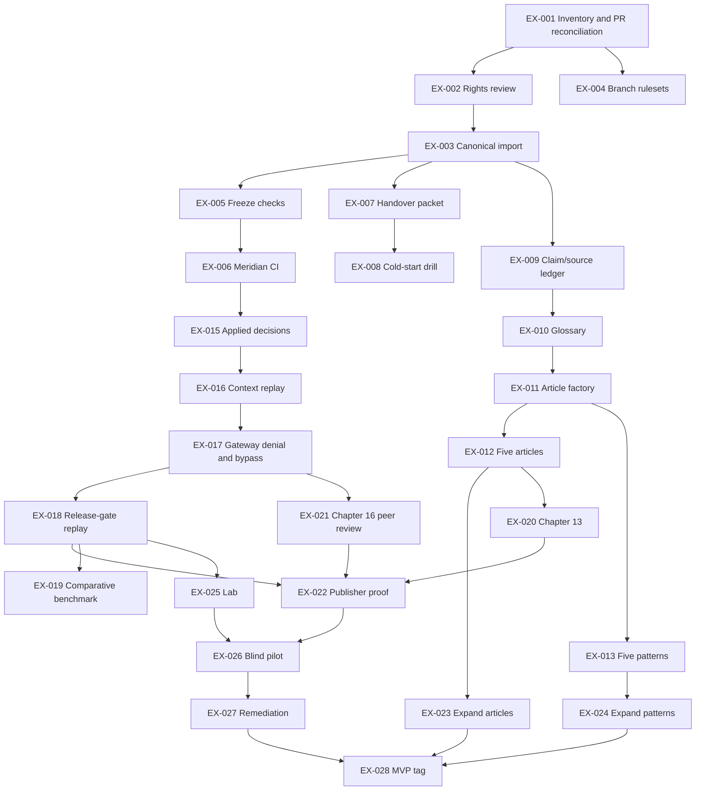

# MASTER EXECUTION BACKLOG — Enterprise AI Agent Fabric + Knowledge MVP

**Status:** executable planning baseline for review; not a new strategy or change to frozen architecture.  **Date:** 24 November 2026.  **Horizon:** December 2026–November 2027.  **Owner assumption:** one architect, 15 dedicated hours/week, independent reviewers borrowed for approval.  **Status:** all tasks initially `Not Started`; actual GitHub state requires verification before any task is marked complete.

## 0. CTO decision and capacity gate

**Do not attempt to write 100 articles and 100 patterns in year one.** These are **ranked backlogs**, not publication commitments. The 12-month deliverable is **15 independently reviewed articles, 12 tested patterns, three applied decisions, one synthetic Meridian replay, one training lab and one Apress sample**. Prioritise protection of the frozen source over production volume.

- Planned 12-month tasks: **28**, **642 architect-hours**; optional tasks remain beyond 12 months.
- Available capacity: **15 hours/week × 52 = 780 hours/year**. Planning reserve **138 hours (17.7%)** for integration, sick leave, delays and unexpected evidence remediation. No promise of daily full-time delivery.
- At 10 hours/week (520 hours), the full scope is **not feasible**: defer the second-wave article/pattern expansion and benchmark until capacity improves. If review assistance is unavailable, defer the Apress submission rather than self-approve.
- Independent reviewer time is **additional**, budgeted separately. Effort estimates are planning assumptions, not evidence-backed measurement. Carry over uncompleted work; do not silently increase hours.

## Part 1 — Dependency graph, blockers and critical path

**Dependency-longest chain to EX-028**, calculated from estimated hours, is: `EX-001 → EX-002 → EX-003 → EX-005 → EX-006 → EX-015 → EX-016 → EX-017 → EX-018 → EX-022 → EX-026 → EX-027 → EX-028`. Sum of on-chain effort: **308 h**; this is *not* the calendar duration, because branch approvals, reviewer availability, and parallel resource loading also constrain delivery. **EX-004** protection and **EX-020/021** publisher review are separate hard release gates even when they are not on the longest hour-weighted chain.

**Hard blockers:** rights review; verified canonical import; frozen decision and fixture hashes; branch protection; negative-test and release-gate evidence; independent technical/editorial approval. An unapproved public repository import is forbidden; a synthetic receipt is not production proof.

**Highest unlock leverage:** EX-003 baseline enables every downstream task; EX-005 integrity CI protects 58 chapters and 30 decisions; EX-006 fixture replay is prerequisite for both chapters and demos; EX-011 article factory enables repeatable knowledge outputs; EX-015 applied decisions proves the adoptable methodology.

## Part 2 — Knowledge MVP: 100 ranked article candidates

The complete, sortable register is `100-ARTICLE-MVP-CANDIDATES.csv` with rank, stable planning ID, domain, specific reason, owner role, chapter/Atlas crosswalk, effort and acceptance. **These `KA-` IDs are backlog IDs, not new frozen book identifiers.** Ten domains × ten candidates deliberately span the future engineering system, but **only the first 15** are required to be completed and reviewed this year. Ranks 16–30 are reserve; 31–100 stay as deferred candidates. The domain-to-chapter mappings are broad editorial crosswalks, **not claims of exact per-article authority**.

| Domain | Candidate count | Key initial article | Book and decision relationship |
|---|---:|---|---|
| Baseline & Method | 10 | Source-of-truth and evidence authority | Ch 5,23,40,52,57; D-01,D-02,D-23,D-24,D-29 |
| Identity & Access | 10 | Human, service and agent principals | Ch 7,15,16,19,21; D-04,D-10,D-19,D-20,D-25 |
| Context, Data & Memory | 10 | Source-level ACL recheck after search | Ch 13,18,21,57; D-11,D-12,D-13,D-14,D-25 |
| Gateway, APIs & Integration | 10 | Authorisation receipt versus denial receipt | Ch 12,14,16,22; D-09,D-10,D-15,D-18,D-21 |
| Verification & Observability | 10 | Release gate assertions and blockers | Ch 17,18,33,40,57; D-22,D-23,D-24,D-27 |
| Security & Data Protection | 10 | KMS, HSM and key ownership | Ch 11,16,19,21,48; D-07,D-09,D-10,D-18,D-25 |
| Platform & Operations | 10 | GitLab runners and executor isolation | Ch 8,14,32,35,36; D-06,D-07,D-08,D-15,D-27 |
| Economics & Sourcing | 10 | Cost per safe successful task | Ch 1,6,8,20,38; D-01,D-02,D-03,D-17,D-26 |
| Networking & Infrastructure | 10 | Network segmentation and east-west policy | Ch 7,11,16,36; D-04,D-07,D-08,D-18 |
| Learning & Lifecycle | 10 | Learning objectives and assessed competency | Ch 23,34,35,49,50; D-24,D-29,D-30 |

**Editorial rule:** a high-ranked article is still excluded until its source rights, primary references, deterministic baseline and independent review are complete. An imported generated summary is not an article.

## Part 3 — Pattern library MVP: 100 ranked candidates

The complete register `100-ENGINEERING-PATTERN-CANDIDATES.csv` carries rank, planning ID, named pattern, why, where used, priority, Fabric chapter and Atlas relationships, and mandatory test/limitation. These patterns are **editorial proposals synthesised from the reviewed sources and established engineering knowledge**; they are **not** represented as 100 patterns already implemented, nor as 1:1 quotes from the 18-pattern archive mapping.

| Group | Candidates | First proposed pattern | Required proof before publication |
|---|---:|---|---|
| Governance and Knowledge | 10 | Canonical source with derived views | Positive/negative scenario, scope limits, operational consequence |
| Quality and Verification | 10 | Fixture checksum and stable IDs | Positive/negative scenario, scope limits, operational consequence |
| Authority and Security | 10 | Mandatory policy enforcement point | Positive/negative scenario, scope limits, operational consequence |
| Context and Evidence | 10 | Explicit unresolved state | Positive/negative scenario, scope limits, operational consequence |
| Contracts and Runtime | 10 | Transactional idempotency key | Positive/negative scenario, scope limits, operational consequence |
| Cost and Sourcing | 10 | No-AI baseline as mandatory option | Positive/negative scenario, scope limits, operational consequence |
| Platform Reuse | 10 | Isolated ephemeral executor | Positive/negative scenario, scope limits, operational consequence |
| Distributed Systems | 10 | Partition key aligned to tenant | Positive/negative scenario, scope limits, operational consequence |
| Learning and Practice | 10 | Worked incident with reproducible artefacts | Positive/negative scenario, scope limits, operational consequence |
| Lifecycle and Reliability | 10 | Stage-gated autonomy promotion | Positive/negative scenario, scope limits, operational consequence |

**Publish 12 patterns maximum.** Each must contain problem, context, option rejected, deterministic mechanism, boundaries, negative test, failure modes, operating cost, rights-cleared citation and related existing Atlas decision. Inferred crosswalks require editorial verification.

## Part 4 — Source acquisition, review, promotion and retirement

| Source | Intake capture | Verify before use | Review cadence / retirement trigger |
|---|---|---|---|
| Books | Edition, pages, ISBN, rights, brief paraphrase | Claim independently checked against permitted excerpt; no full copyrighted chapter import | New edition or superseded claim |
| Standards and RFCs | Publisher, ID, status, revision, section URL | Distinguish normative from informational/draft; check errata | Status/version supersession |
| Vendor documentation | URL, product/service version, date, capture hash | Current supported behavior and compatibility; do not infer guarantees | Quarterly for critical controls; on release/change |
| Incident and architecture review | Ticket/ADR, reviewer, chronology, redacted lessons | Permission to reuse; separate observed from suspected causes | Corrected incident record or rights withdrawal |
| Workshops and field notes | Date, attendees/author role, anonymised context | Explicitly mark anecdotal versus measured outcomes | After contradictory evidence or loss of permission |
| Research and AI outputs | Prompt, source links, model/tool, validation status | No AI synthesis promoted without primary evidence and human review | Failed validation, source expiry, attribution failure |

**Lifecycle:** `CAPTURED → TRIAGED → SOURCE-VERIFIED → CLAIM-REVIEWED → APPROVED → LINKED → MONITORED → SUPERSEDED/WITHDRAWN`. Reject/quarantine states can occur at any gate. The source ledger records `source_id`, `sha256_or_url`, `edition`, `retrieved_utc`, `owner`, `licence`, `confidentiality`, `claim_id`, `support_or_counterevidence`, `confidence`, `last_review`, `next_review`, `status`, `downstream_ids`. A withdrawal must invalidate derived articles/cheatsheets and generated graph edges; never delete historical evidence without retention/rights disposition.

## Part 5 — Domain stewardship within one-person capacity

The roles below are **review lanes**, not ten funded employees. The architect is interim drafter/custodian across domains. No self-approval of security claims, frozen changes or publication clearance. At least one competent external reviewer is needed for high-risk domains; where unavailable, retain `DRAFT/UNVERIFIED` rather than bypass approval.

| Steward role | Decision boundary | Minimum independent challenger |
|---|---|---|
| Knowledge/Configuration Steward | Canonical paths, version IDs, source integrity, aliases | Independent maintainer/editor |
| Identity Steward | Principal/token/delegation and tenancy semantics | Identity/security engineer |
| Security Steward | Authorization, keys, supply chain, negative tests | Independent security architect |
| Networking Steward | Private paths, egress, TLS, service mesh, segmentation | Network/security engineer |
| Platform Steward | IaC, runners, Kubernetes, workers, availability | Platform/SRE engineer |
| Data/Memory Steward | Records, classification, provenance, reconciliation | Data architect/privacy reviewer |
| Integration Steward | OpenAPI, MCP/A2A, messaging, contract evolution | Integration specialist |
| SRE/Observability Steward | Runbooks, metrics, evidence, incident lifecycle | SRE reviewer |
| FinOps Steward | Unit economics, capacity, sourcing assumptions | Finance/FinOps reviewer |
| AI/Verification Steward | Evaluations, test corpus, model routing | Independent evaluation specialist |
| Editorial/IP Steward | Style, licence, attribution and print readiness | Editor/rights holder |
| Learning Steward | Learning outcomes and assessed exercises | Practitioner/learner assessor |

## Part 6 — The article factory (one executable vertical slice)

`Source note (evidence and licence) → Research dossier (claim / counterclaim / versions) → Knowledge article (problem / mechanism / boundaries) → Decision guide (when / when not / defaults) → Cheat sheet (generated projection) → Learning asset (scenario / test / scoring)`

**Input acceptance:** verified source and rights. **Article acceptance:** one controlled term definition, concrete decision or mechanism, one falsifiable failure, deterministic alternative, operating cost, reviewed chapter/Atlas links. **Derived outputs:** generated from the same article/version; no manually edited second truth. **Release check:** broken links, missing citations, stale source, disallowed ID changes, confidential data, schema errors, unresolved review findings fail the gate. **Test run:** create one source note, transform each stage, intentionally change source claim, prove downstream derived pages are invalidated, not silently left published.

## Part 7 — Month-by-month 12-month programme

| Month | Core execution | Acceptance evidence | Planned architect effort (hours, evenly spread across windows) |
|---|---|---|---:|
| M1 · Dec 2026 | Establish custody: inventory three PRs, source hashes, rights review, protect main (no premature merge). | Inventory complete, import classification accepted, ruleset or documented blocker. | 46 |
| M2 · Jan 2027 | Complete canonical import and freeze checks for TOC, Atlas and style; begin CI hard-fail tests. | Clean checkout reproduces 58, 30 and approved checksums. | 60 |
| M3 · Feb 2027 | Meridian validator in CI, portable cross-tool handover, research claim ledger. | 27/27 fixture tests in isolated CI and one successful clean-room handover. | 52 |
| M4 · Mar 2027 | Start article factory, applied-decision template, 30-term glossary. | One source converts to reviewed article, derived guide and cheat sheet. | 66 |
| M5 · Apr 2027 | Publish first five articles and five engineering patterns; start applied D-10/D-14/D-18. | Five reviewed pieces of each type; three applied ADRs under review. | 62 |
| M6 · May 2027 | Replay Context ACL and contradiction cases; write Chapter 13 under frozen F6. | Denied cross-tenant input, unresolved retail status, no invented memory write. | 59 |
| M7 · Jun 2027 | Replay delegation, Gateway denial, bypass test; continue Chapter 13. | Separate enforcement and egress failures observable; zero ledger mutation. | 61 |
| M8 · Jul 2027 | Release-gate BLOCK_PROMOTION and deterministic-only versus AI experiment; Chapter 16 review. | Replayed failed candidate; comparative results with transparent costs and test set. | 60 |
| M9 · Aug 2027 | Assemble immutable publisher sample; expand approved article and pattern corpus. | Proof-of-book has independent signoff and checksum manifest. | 59 |
| M10 · Sep 2027 | Complete 15-article/12-pattern ceiling and one assessed lab. | All assets source-linked; lab has reset and scoring instructions. | 59 |
| M11 · Oct 2027 | Run three independent cold-start learner/reviewer trials and remedy failures. | Measured completion/error data; top five defects assigned and reproduced. | 30 |
| M12 · Nov 2027 | Retest fixes, record remaining limits and tag v0.1 proof release. | From clean checkout, reviewer rebuilds fixture and major evidence with no chat history. | 28 |

Monthly loading is an estimate: allocations split multi-month tasks uniformly; **M4 is approximately 66h versus a 65h monthly average**. Move one hour to M3 or use contingency. The plan requires regular **15h/week protected time** and external review slots; a 10h/week reality means change scope before starting. If source rights and GitHub controls are unresolved at end of M2, STOP demo and publishing commitments until fixed.

## Part 8 — Kill / defer list

| Decision | Candidate | Rationale / re-entry trigger |
|---|---|---|
| STOP | New multi-year strategies, method labels and control planes | No more architecture prose before a run/test/approval |
| STOP | Auto-generating the 100 articles or 100 patterns | 200 unchecked pages would become liability |
| STOP | Claims of certification or production security from Meridian | Fixture is fictional and negative controls are simulated |
| DEFER | Graph database, embeddings and semantic search platform | Use static IDs, CSV/Markdown and deterministic indexing first; revisit after >500 reviewed assets |
| DEFER | 10,000 article encyclopedia | Publish 15, measure maintenance and reader value |
| DEFER | Marketplace/plugin ecosystem and commercial agent platform | No independently measured need or support model |
| DEFER | Formal certification and commercial software | No independent adopters or repeatable paid demand |
| DEFER | Multi-cloud implementation matrix and general AI framework | One bounded synthetic simulator is enough for proof |
| CONDITIONAL | LLM-assisted demo mode | Only after deterministic baseline exposes unsolved ambiguity and evaluation value |
| STOP | Publishing unreviewed historical enterprise archives | Confidentiality and third-party rights unverified |

## Part 9 — CTO execution instructions and stop conditions

**Next 10 deliverables, in order:** (1) approved authority manifest; (2) rights-cleared import; (3) branch protection; (4) CI freeze checker; (5) Meridian CI proof; (6) cold-start handover; (7) applied D-10/D-14/D-18 review; (8) deterministic Meridian replay; (9) Apress two-chapter evidence package; (10) blind pilot and versioned MVP release. These are real files/tests and reviewer outcomes, not another roadmap.

**Hard stop conditions:** no source-rights approval; any frozen hash mismatch; failing negative test; evidence claiming a real ledger mutation; incorrect policy/denial receipt interpretation; missing reviewer or revoked approval; failed requalification; more than 15% schedule overrun without re-scoping. **Done** means checks and acceptance evidence at a specific commit, not prose saying complete.

## Full ranked register — 100 knowledge articles

| Rank / ID | Domain | Article | Why it earns a place |
|---|---|---|---|
| 1 / KA-001 | Baseline & Method | Source-of-truth and evidence authority | Prevents a working note from overruling a frozen source |
| 2 / KA-002 | Baseline & Method | Git baselines and reproducible builds | Makes every result tied to a recoverable revision |
| 3 / KA-003 | Baseline & Method | Decision Atlas versus applied ADR | Separates recommended defaults from a real approval |
| 4 / KA-004 | Baseline & Method | Decision-to-evidence trace contract | Links a chosen control to tests and observed outcome |
| 5 / KA-005 | Baseline & Method | Evidence grades: designed, tested, deployed | Stops simulated records becoming production claims |
| 6 / KA-006 | Baseline & Method | Rights, citation and source custody | Prevents publishing unlicensed or confidential material |
| 7 / KA-007 | Identity & Access | Human, service and agent principals | Distinguishes actor authority from workload execution |
| 8 / KA-008 | Identity & Access | Delegation and scope attenuation | Prevents downstream authority amplification |
| 9 / KA-009 | Identity & Access | PDP versus PEP boundaries | Separates permit decisions from actual enforcement |
| 10 / KA-010 | Context, Data & Memory | Source-level ACL recheck after search | Catches stale or mislabelled index results |
| 11 / KA-011 | Context, Data & Memory | Context manifest schema and provenance | Makes retrieval choices auditable |
| 12 / KA-012 | Context, Data & Memory | Persistent disagreement and escalation | Represents conflict without silent source precedence |
| 13 / KA-013 | Gateway, APIs & Integration | Authorisation receipt versus denial receipt | Stops DENY records being reused as permits |
| 14 / KA-014 | Gateway, APIs & Integration | Gateway non-bypassability and egress | Requires independent negative-route tests |
| 15 / KA-015 | Verification & Observability | Release gate assertions and blockers | Makes safety failures stop promotion |
| 16 / KA-016 | Context, Data & Memory | Retrieval filtering before model context | Prevents unauthorised retrieved data from being consumed |
| 17 / KA-017 | Identity & Access | Tenant isolation and cross-tenant denial | Proves source rechecks rather than trusting index tags |
| 18 / KA-018 | Gateway, APIs & Integration | Idempotency and external mutation semantics | Explains why exactly-once cannot be assumed |
| 19 / KA-019 | Verification & Observability | Offline evaluation datasets and baselines | Supports reproducible model release decisions |
| 20 / KA-020 | Context, Data & Memory | Working context versus durable memory | Prevents transient claims becoming persistent facts |
| 21 / KA-021 | Security & Data Protection | KMS, HSM and key ownership | Clarifies custody and signing trust |
| 22 / KA-022 | Gateway, APIs & Integration | Action contracts and side effects | Differentiates read intent from mutation |
| 23 / KA-023 | Platform & Operations | GitLab runners and executor isolation | Ensures build agents cannot cross trust zones |
| 24 / KA-024 | Verification & Observability | Run, thread, trace, span and trajectory | Removes ambiguity in correlated evidence |
| 25 / KA-025 | Economics & Sourcing | Cost per safe successful task | Avoids optimising token price alone |
| 26 / KA-026 | Networking & Infrastructure | Network segmentation and east-west policy | Defines trust-zone boundaries for service traffic |
| 27 / KA-027 | Learning & Lifecycle | Learning objectives and assessed competency | Distinguishes reading from demonstrated skill |
| 28 / KA-028 | Identity & Access | OAuth versus OIDC versus SAML | Prevents authentication protocols from being confused |
| 29 / KA-029 | Security & Data Protection | PKI, certificates and mTLS | Secures service identity and connections |
| 30 / KA-030 | Platform & Operations | Terraform plan, apply and state ownership | Preserves review and recovery independence |
| 31 / KA-031 | Verification & Observability | Telemetry versus audit evidence | Prevents sampling from erasing accountable decisions |
| 32 / KA-032 | Economics & Sourcing | Model routing and fallback economics | Measures risk, cost and quality trade-offs |
| 33 / KA-033 | Networking & Infrastructure | DNS discovery and service naming | Avoids endpoint ambiguity and brittle addressing |
| 34 / KA-034 | Learning & Lifecycle | Scenario-based architecture review | Makes decisions teachable through realistic cases |
| 35 / KA-035 | Identity & Access | Workload identity federation | Avoids persistent shared credentials |
| 36 / KA-036 | Security & Data Protection | Secret lifecycle and rotation | Limits credential leakage windows |
| 37 / KA-037 | Platform & Operations | Kubernetes reconciler versus batch job | Chooses a runtime suitable to workload duration |
| 38 / KA-038 | Economics & Sourcing | Build versus buy versus embed | Selects ownership according to control needs |
| 39 / KA-039 | Networking & Infrastructure | Load balancing and health checks | Separates availability decisions from traffic routing |
| 40 / KA-040 | Learning & Lifecycle | Hands-on denial and failure lab | Trains independent evidence interpretation |
| 41 / KA-041 | Identity & Access | Audience and token expiry validation | Limits replay and token misuse |
| 42 / KA-042 | Security & Data Protection | Policy as code versus cloud resource policy | Avoids treating environment rules as business authorisation |
| 43 / KA-043 | Context, Data & Memory | Canonical entity matching | Keeps identity resolution distinct from truth |
| 44 / KA-044 | Platform & Operations | Resource quotas and tenant budgets | Bounds noisy neighbours and overspend |
| 45 / KA-045 | Verification & Observability | Online evaluation and drift detection | Separates live monitoring from offline correctness |
| 46 / KA-046 | Economics & Sourcing | Reusable control business case | Prevents shared platforms without funded consumers |
| 47 / KA-047 | Networking & Infrastructure | Private connectivity and egress design | Constrains data flows to approved routes |
| 48 / KA-048 | Learning & Lifecycle | Peer review and reproducibility rubric | Supports quality when authors change |
| 49 / KA-049 | Security & Data Protection | Prompt injection and tool-output trust | Defines untrusted model inputs and action boundaries |
| 50 / KA-050 | Context, Data & Memory | Bitemporal records and effective time | Prevents timestamp order deciding business authority |
| 51 / KA-051 | Gateway, APIs & Integration | REST and OpenAPI compatibility | Uses machine-readable contracts instead of prompts |
| 52 / KA-052 | Platform & Operations | Redis cache versus durable queue | Prevents cache loss being mistaken for workflow completion |
| 53 / KA-053 | Verification & Observability | Golden-set versioning and contamination | Controls benchmark leakage and regression noise |
| 54 / KA-054 | Economics & Sourcing | Capacity and queueing fundamentals | Translates throughput requirements into safe limits |
| 55 / KA-055 | Networking & Infrastructure | IP address and CIDR overlap management | Prevents cross-network routing mistakes |
| 56 / KA-056 | Learning & Lifecycle | Architecture trade-off workshop facilitation | Trains defensible rather than slogan choices |
| 57 / KA-057 | Baseline & Method | Research claim and contradiction ledger | Allows disputed claims to remain reviewable |
| 58 / KA-058 | Identity & Access | On-behalf-of and token exchange | Makes multi-hop actor identity inspectable |
| 59 / KA-059 | Security & Data Protection | Supply-chain signing, SBOM and provenance | Tests trust in binaries and plugins |
| 60 / KA-060 | Gateway, APIs & Integration | MCP capability registration and trust | Prevents tool listing from implying authorisation |
| 61 / KA-061 | Platform & Operations | Kafka versus RabbitMQ versus cloud queues | Matches ordering and durability to workload needs |
| 62 / KA-062 | Economics & Sourcing | Cloud cost attribution and chargeback | Makes spend traceable by workload and tenant |
| 63 / KA-063 | Networking & Infrastructure | Service mesh identity and policy | Distinguishes mTLS transport from action authorisation |
| 64 / KA-064 | Learning & Lifecycle | Platform onboarding and consumer adoption | Captures friction and service ownership |
| 65 / KA-065 | Security & Data Protection | Data classification and consent lineage | Controls sensitive context inclusion |
| 66 / KA-066 | Gateway, APIs & Integration | A2A delegation and provenance exchange | Secures actor claims across agent boundaries |
| 67 / KA-067 | Platform & Operations | Durable workflow checkpoint and resume | Requires safe replay and renewed authority |
| 68 / KA-068 | Verification & Observability | Synthetic negative-test harness | Exercises denial cases without real side effects |
| 69 / KA-069 | Economics & Sourcing | Technology selection and weighted evidence | Prevents unexamined vendor preference |
| 70 / KA-070 | Networking & Infrastructure | Zero-trust network access | Assumes no implicit zone-based permission |
| 71 / KA-071 | Learning & Lifecycle | Release to operations handover | Avoids orphaned controls and undocumented runbooks |
| 72 / KA-072 | Baseline & Method | AI-to-human handover by commit | Makes authorship independent of a model context window |
| 73 / KA-073 | Identity & Access | RBAC, ABAC and ReBAC selection | Matches permission model to risk and scale |
| 74 / KA-074 | Security & Data Protection | Encryption at rest and in transit | Names protections and remaining exposures |
| 75 / KA-075 | Context, Data & Memory | Memory write admission and approval | Applies explicit trust checks to persistence |
| 76 / KA-076 | Gateway, APIs & Integration | Event schemas and schema evolution | Prevents incompatible producer-consumer changes |
| 77 / KA-077 | Platform & Operations | Golden paths and platform product contracts | Reduces platform onboarding complexity |
| 78 / KA-078 | Verification & Observability | Evidence integrity and correlated timestamps | Enables independent reconstruction |
| 79 / KA-079 | Economics & Sourcing | Sensitivity analysis for architecture options | Exposes assumptions that change recommendations |
| 80 / KA-080 | Networking & Infrastructure | Resilient ingress and API exposure | Protects entry paths under failure |
| 81 / KA-081 | Learning & Lifecycle | Retirement, key withdrawal and teardown | Makes authority removal a lifecycle gate |
| 82 / KA-082 | Baseline & Method | Review gates and negative evidence | Makes a failing test a stop condition |
| 83 / KA-083 | Security & Data Protection | Retention, erasure and derivative copies | Prevents false claims of complete deletion |
| 84 / KA-084 | Context, Data & Memory | Memory sharing across agents | Preserves tenant and actor restrictions across transfer |
| 85 / KA-085 | Gateway, APIs & Integration | API gateway versus service mesh | Separates edge routing from service traffic enforcement |
| 86 / KA-086 | Platform & Operations | Plugin lifecycle and sandbox trust | Limits extension blast radius |
| 87 / KA-087 | Verification & Observability | Incident command and evidence preservation | Protects forensic records during containment |
| 88 / KA-088 | Economics & Sourcing | Vendor exit clauses and portability | Limits contract lock-in |
| 89 / KA-089 | Networking & Infrastructure | Observability for network paths | Correlates latency and drops with service intent |
| 90 / KA-090 | Learning & Lifecycle | Data and evidence export at exit | Tests audit continuity after migration |
| 91 / KA-091 | Baseline & Method | Deterministic versus model-first selection | Avoids model calls when ordinary software suffices |
| 92 / KA-092 | Identity & Access | Break-glass approval and revocation | Constrains emergency power and audit obligations |
| 93 / KA-093 | Security & Data Protection | Threat modelling and red-team negative tests | Converts threat hypotheses into reproducible checks |
| 94 / KA-094 | Context, Data & Memory | Memory deletion and negative proof | Tests derived-copy removal and bounded deletion claims |
| 95 / KA-095 | Gateway, APIs & Integration | Circuit breakers, retries and backpressure | Keeps overloaded dependencies from cascading |
| 96 / KA-096 | Platform & Operations | Disaster recovery and state restoration | Tests recovery without restoring unsafe permissions |
| 97 / KA-097 | Verification & Observability | SLO and error budget engineering | Connects user outcomes to operating thresholds |
| 98 / KA-098 | Economics & Sourcing | Human review effort and exception cost | Includes true operating labour in unit economics |
| 99 / KA-099 | Networking & Infrastructure | Network disaster recovery and testing | Makes fallback paths subject to the same policy |
| 100 / KA-100 | Learning & Lifecycle | Continuous knowledge maintenance and expiry | Prevents 10,000 stale articles accumulating |

## Full ranked register — 100 engineering patterns

| Rank / ID | Group | Pattern | Why / required consequence |
|---|---|---|---|
| 1 / EP-001 | Governance and Knowledge | Canonical source with derived views | Prevent conflicting editable copies |
| 2 / EP-002 | Quality and Verification | Fixture checksum and stable IDs | Detect accidental reference data mutation |
| 3 / EP-003 | Authority and Security | Mandatory policy enforcement point | Stop the call rather than log a DENY |
| 4 / EP-004 | Authority and Security | Monotonic delegation attenuation | Intersect effective scope at each hop |
| 5 / EP-005 | Authority and Security | Egress deny by default | Disallow direct routes to mutable targets |
| 6 / EP-006 | Authority and Security | Tenant source-level recheck | Reject index labels as an access grant |
| 7 / EP-007 | Context and Evidence | Explicit unresolved state | Block silent conflict winner selection |
| 8 / EP-008 | Context and Evidence | Provenance-carrying context envelope | Preserve source and classification through retrieval |
| 9 / EP-009 | Contracts and Runtime | Transactional idempotency key | Deduplicate requests before side effect |
| 10 / EP-010 | Quality and Verification | Negative test before approval | Prove forbidden paths are stopped |
| 11 / EP-011 | Quality and Verification | Release gate on critical assertion | Block promotion despite partial success |
| 12 / EP-012 | Quality and Verification | Evidence grading and claim status | Separate designed, simulated and deployed |
| 13 / EP-013 | Cost and Sourcing | No-AI baseline as mandatory option | Make deterministic alternative visible |
| 14 / EP-014 | Quality and Verification | Independent reviewer replay | Validate outside author context |
| 15 / EP-015 | Contracts and Runtime | Contract-first API evolution | Reject breaking schema changes before release |
| 16 / EP-016 | Authority and Security | Fail-closed mutation admission | Deny when policy cannot return a trustworthy result |
| 17 / EP-017 | Platform Reuse | Isolated ephemeral executor | Reduce per-task credential persistence |
| 18 / EP-018 | Distributed Systems | Partition key aligned to tenant | Contain cross-tenant data access |
| 19 / EP-019 | Learning and Practice | Worked incident with reproducible artefacts | Teach consequences not slogans |
| 20 / EP-020 | Lifecycle and Reliability | Stage-gated autonomy promotion | Tie risk envelope to observed results |
| 21 / EP-021 | Platform Reuse | Declarative desired-state reconciliation | Detect configuration drift |
| 22 / EP-022 | Distributed Systems | Consumer group with replayable offsets | Recover event processing independently |
| 23 / EP-023 | Cost and Sourcing | Conditional model invocation | Call a model only for an ambiguous task |
| 24 / EP-024 | Governance and Knowledge | Signed baseline manifest | Pin authority to approved file versions |
| 25 / EP-025 | Learning and Practice | Pre/post competency test | Measure learning rather than attendance |
| 26 / EP-026 | Lifecycle and Reliability | Continuous requalification trigger | Reassess after material environment change |
| 27 / EP-027 | Authority and Security | Audience-bound short-lived claims | Check recipient and expiry, not token presence |
| 28 / EP-028 | Context and Evidence | Canonical entity key with raw ID retention | Keep identity matching reversible and auditable |
| 29 / EP-029 | Contracts and Runtime | Outbox with durable event delivery | Bridge local commit and asynchronous delivery |
| 30 / EP-030 | Platform Reuse | Approval before infrastructure apply | Separate plan from irreversible effect |
| 31 / EP-031 | Distributed Systems | Backpressure at queue boundary | Avoid propagating load spikes |
| 32 / EP-032 | Cost and Sourcing | Model routing by measured quality budget | Avoid lowest-cost-only routing |
| 33 / EP-033 | Governance and Knowledge | Stable knowledge ID and alias map | Survive rename and path relocation |
| 34 / EP-034 | Learning and Practice | Blind peer application of Atlas | Test method usability outside author |
| 35 / EP-035 | Lifecycle and Reliability | Incident stop-action switch | Contain unsafe actions before analysis |
| 36 / EP-036 | Context and Evidence | Bitemporal reconciliation | Compare effective and recorded time separately |
| 37 / EP-037 | Contracts and Runtime | Inbox deduplication on consumer | Tolerate at-least-once message delivery |
| 38 / EP-038 | Platform Reuse | GitOps signed provenance trail | Tie config deployment to reviewed commit |
| 39 / EP-039 | Quality and Verification | Offline golden-set regression | Compare candidate against versioned cases |
| 40 / EP-040 | Distributed Systems | Bulkhead isolation by workload class | Stop one dependency exhausting workers |
| 41 / EP-041 | Cost and Sourcing | Cache bounded by confidentiality and TTL | Avoid unsafe reuse of sensitive output |
| 42 / EP-042 | Governance and Knowledge | Claim ledger with contradiction edges | Preserve dissent and negative evidence |
| 43 / EP-043 | Learning and Practice | Decision guide with no-choice outcome | Prevent forced tool selection |
| 44 / EP-044 | Lifecycle and Reliability | Audit evidence hold with access control | Preserve investigations without oversharing |
| 45 / EP-045 | Context and Evidence | Quarantine invalid retrieval | Exclude suspect results before model use |
| 46 / EP-046 | Contracts and Runtime | Bounded retry with exponential backoff | Prevent retry storms and unbounded spend |
| 47 / EP-047 | Platform Reuse | Resource quotas and per-tenant limits | Prevent noisy-neighbour exhaustion |
| 48 / EP-048 | Quality and Verification | Online monitor with sampled calibration | Detect drift while acknowledging sampling |
| 49 / EP-049 | Distributed Systems | Saga compensation with explicit limits | Avoid assuming automatic undo of effects |
| 50 / EP-050 | Cost and Sourcing | Per-task token and tool budget | Cap runaway autonomous work |
| 51 / EP-051 | Governance and Knowledge | Research source expiry and revalidation | Catch vendor documentation drift |
| 52 / EP-052 | Learning and Practice | Failure injection in safe sandbox | Experience denials without harm |
| 53 / EP-053 | Lifecycle and Reliability | Retirement inventory of credentials and data | Make teardown auditable |
| 54 / EP-054 | Authority and Security | Credential isolation per trust zone | Keep high privilege outside broad worker pools |
| 55 / EP-055 | Context and Evidence | Memory write admission gate | Separate context consumption from persistence |
| 56 / EP-056 | Contracts and Runtime | Circuit breaker on unstable dependency | Contain downstream failure |
| 57 / EP-057 | Platform Reuse | Cache-aside with authoritative fallback | Treat cache as acceleration, not truth |
| 58 / EP-058 | Quality and Verification | Differential deterministic-versus-LLM test | Quantify model value beyond correctness alone |
| 59 / EP-059 | Distributed Systems | State-machine transition guard | Reject invalid workflow jumps |
| 60 / EP-060 | Cost and Sourcing | Cost per safe successful task metric | Include failed and human-reviewed work |
| 61 / EP-061 | Governance and Knowledge | PR reviewer separation of duties | Prevent self-approval of high-risk claims |
| 62 / EP-062 | Learning and Practice | Role-based learning objective map | Align depth with responsibility |
| 63 / EP-063 | Lifecycle and Reliability | Identity revocation rehearsal | Prove expired principals lose access |
| 64 / EP-064 | Authority and Security | Scoped break-glass grant | Expiring exceptional access with review |
| 65 / EP-065 | Context and Evidence | Memory tombstone propagation | Track derivative deletion and unresolved copies |
| 66 / EP-066 | Contracts and Runtime | Timeout and cancellation propagation | Stop abandoned execution paths |
| 67 / EP-067 | Platform Reuse | Durable queue over ephemeral signal | Prevent lost work on worker restart |
| 68 / EP-068 | Quality and Verification | Canary release with rollback predicate | Limit blast radius of behavioural changes |
| 69 / EP-069 | Distributed Systems | Deterministic event ordering by key | Document limits of global ordering |
| 70 / EP-070 | Cost and Sourcing | Build-buy-embed decision record | Surface integration and exit costs |
| 71 / EP-071 | Governance and Knowledge | AI handover packet pinned to SHA | Make state reconstructable across tools |
| 72 / EP-072 | Learning and Practice | Cheat sheet generated from canonical article | Avoid independent contradictory short copy |
| 73 / EP-073 | Lifecycle and Reliability | Data export with integrity manifest | Preserve migration and audit portability |
| 74 / EP-074 | Authority and Security | Two-party high-risk approval | Prevent unilateral irreversible action |
| 75 / EP-075 | Context and Evidence | Immutable evidence reference with redaction | Retain integrity without exposing secrets |
| 76 / EP-076 | Contracts and Runtime | Dead-letter with operator replay | Make poison messages inspectable |
| 77 / EP-077 | Platform Reuse | Autoscale on useful backlog signal | Avoid scaling on misleading CPU alone |
| 78 / EP-078 | Quality and Verification | Shadow-mode recommendation only | Observe without authorising mutations |
| 79 / EP-079 | Distributed Systems | Checkpoint plus external effect ledger | Avoid double effects after restart |
| 80 / EP-080 | Cost and Sourcing | Sensitivity test on unit economics | Expose changes that reverse sourcing choices |
| 81 / EP-081 | Governance and Knowledge | Article promotion only with citations | Separate note from approved guidance |
| 82 / EP-082 | Learning and Practice | Lab reset and cleanup script | Make exercises reproducible |
| 83 / EP-083 | Lifecycle and Reliability | Backup recovery independent of platform | Avoid circular recovery dependency |
| 84 / EP-084 | Context and Evidence | Trace-to-case correlation invariant | Reconstruct why an action was attempted |
| 85 / EP-085 | Contracts and Runtime | Durable workflow checkpoint | Resume from persisted progress |
| 86 / EP-086 | Platform Reuse | Golden path as tested contract | Reduce variance for common workflows |
| 87 / EP-087 | Distributed Systems | Timeout budget across service chain | Keep tail latency within contract |
| 88 / EP-088 | Cost and Sourcing | Shared-service funding threshold | Require funded demand before centralising |
| 89 / EP-089 | Governance and Knowledge | Deprecation with redirect and withdrawal | Avoid silently breaking readers |
| 90 / EP-090 | Learning and Practice | Accessibility review for diagrams | Make architecture usable beyond visuals |
| 91 / EP-091 | Lifecycle and Reliability | Runbook tested from clean environment | Prove restoration outside author memory |
| 92 / EP-092 | Authority and Security | Policy bundle pinning and drift alert | Tie decisions to reviewed rule versions |
| 93 / EP-093 | Context and Evidence | Counterevidence linked to claim | Avoid certainty from one supporting record |
| 94 / EP-094 | Contracts and Runtime | Authority recheck on resume | Do not restore expired delegation |
| 95 / EP-095 | Platform Reuse | Plugin sandbox with capability manifest | Constrain extension access and upgrade |
| 96 / EP-096 | Distributed Systems | Disaster-recovery credential rotation | Avoid restoring invalid credentials |
| 97 / EP-097 | Cost and Sourcing | Exit rehearsal before lock-in | Prove data and identity portability |
| 98 / EP-098 | Governance and Knowledge | Rights clearance before public export | Protect third-party and employer material |
| 99 / EP-099 | Learning and Practice | Instructor feedback into issue backlog | Convert learner confusion into improvements |
| 100 / EP-100 | Lifecycle and Reliability | Support ownership acceptance before go-live | Avoid orphaned services |

## Exact task backlog (execution contract)

| ID | Workstream | Deliverable | Dependencies | Hours | Month | DoD |
|---|---|---|---|---:|---|---|
| EX-001 | Baseline | Reconcile existing draft PRs and freeze authority inventory | — | 20 | M1 | Approved inventory with immutable upstream hash and disposition for each source |
| EX-002 | Baseline | Rights and confidentiality clearance of import candidates | EX-001 | 20 | M1-M2 | No uncleared archives or sensitive extracts enter public repo |
| EX-003 | Baseline | Commit canonical frozen files and manifest on reviewed PR | EX-001,EX-002 | 28 | M2 | Fresh checkout resolves every frozen ID and byte hash |
| EX-004 | Controls | Apply rulesets, CODEOWNERS and reviewer identities | EX-001 | 16 | M1 | Protected main; failing checks block merge; reviewer named |
| EX-005 | Controls | Implement freeze checks for 58 TOC, 30 decisions, Style Bible | EX-003,EX-004 | 22 | M2 | Intentional mutation triggers red CI in fork/PR |
| EX-006 | Controls | Reproduce Meridian 27 tests in CI | EX-003,EX-005 | 14 | M3 | 27 tests pass; fixture modification causes deterministic failure |
| EX-007 | Continuity | Create session state, handover and task templates | EX-003 | 16 | M3 | Cross-tool packet includes SHA, status, known limitations |
| EX-008 | Continuity | Clean-room handover drill with human or alternate model | EX-007 | 12 | M3 | Independent actor finds next task and recreates tests |
| EX-009 | Source | Build minimal source/claim/rights ledger with expiry | EX-002,EX-003 | 20 | M3-M4 | 20 claims have source URL/hash, contradiction and status |
| EX-010 | Glossary | Approve 30 canonical terms with aliases and ownership | EX-003,EX-009 | 18 | M4 | Automated duplicate and dangling-link scan |
| EX-011 | Knowledge | Implement one article factory in Markdown + schema tests | EX-009,EX-010 | 24 | M4 | Source note→dossier→article→guide→cheat sheet regenerable |
| EX-012 | Knowledge | Publish first 5 peer-reviewed articles | EX-011 | 24 | M5 | 5 articles meet citation, challenge and deterministic criteria |
| EX-013 | Patterns | Publish first 5 test-backed patterns | EX-011 | 24 | M5 | 5 patterns with constraints and reproducible checks |
| EX-014 | Method | Create applied decision template distinct from frozen Atlas | EX-003,EX-009 | 14 | M4 | Owner, option, scope, proof and renewal distinct from Atlas |
| EX-015 | Method | Complete applied D-10, D-14 and D-18 examples | EX-006,EX-014 | 28 | M5-M6 | Three examples accepted by an independent reviewer |
| EX-016 | Demo | Implement source-ACL and contradictory-context replay | EX-006,EX-015 | 34 | M6 | Fixture event replay with exact canonical IDs; no false writes |
| EX-017 | Demo | Implement scope/PEP deny and direct-egress negative simulator | EX-016 | 38 | M7 | Denied mutation and separate bypass path both reproducible |
| EX-018 | Demo | Implement release assertion and evidence replay | EX-017 | 24 | M7-M8 | Failure BLOCK_PROMOTION matches fixture, no promoted candidate |
| EX-019 | Benchmark | Run deterministic-only versus optional LLM baseline | EX-016,EX-017,EX-018 | 30 | M8 | Same tests, quality, costs and failure counts published |
| EX-020 | Book | Complete Chapter 13 prose from frozen F6 blueprint | EX-006,EX-012 | 22 | M6-M7 | Technical editor accepts F6 and fixture accuracy |
| EX-021 | Book | Independent technical review Chapter 16 and D-10/D-18 | EX-005,EX-017 | 18 | M8 | Logged severe findings resolved; figures rendered |
| EX-022 | Book | Produce immutable Apress proof-of-book package | EX-020,EX-021,EX-018 | 22 | M9 | Sample, proposal and hash manifest editorially accepted |
| EX-023 | Knowledge | Expand from 5 to 15 verified articles | EX-012,EX-013 | 44 | M9-M10 | 15 approved and peer-reviewable; no mass auto-generation |
| EX-024 | Patterns | Expand from 5 to 12 validated patterns | EX-013,EX-019 | 30 | M9-M10 | 12 patterns link tested proof and limits |
| EX-025 | Learning | Create one 60-minute lab and assessment rubric | EX-015,EX-018 | 22 | M10 | Learner independently identifies deny-vs-release failure |
| EX-026 | Learning | Run 3-person blind usability pilot | EX-022,EX-025 | 18 | M11 | Measure task time/error and capture corrections |
| EX-027 | Delivery | Fix top five pilot blockers and retest | EX-026 | 24 | M11-M12 | Repeat pilot shows documented change or failed hypothesis |
| EX-028 | Delivery | Publish v0.1 MVP tag, support and known limits | EX-023,EX-024,EX-027 | 16 | M12 | Rebuild and checksum from tag; no unsupported claims |
| EX-029 | Optional | Community handbook and contributor intake pilot | EX-028 | 12 | Beyond | Only after 1 external contributor demonstrated |
| EX-030 | Optional | Graph read-only generated export | EX-028 | 16 | Beyond | Graph rebuilt from sources without manual authority |
| EX-031 | Optional | Commercial workshop pilot | EX-026 | 24 | Beyond | Evidence of willingness-to-pay not assumed |
| EX-032 | Optional | Software proof-of-demand interviews | EX-028 | 14 | Beyond | No custom platform work without validated demand |

## Source integrity and interpretive limits

Derived from the **actual** 60-row `MASTER-GAP-REGISTER.csv`, 18-row `WORKSTREAM-SCORECARD.csv`, 32-dossier plan, 18 archive-reviewed patterns, 30 frozen decision records and 58-row TOC. Source hashes are in `SOURCE-DEPENDENCY-MANIFEST.json`. New `KA-`, `EP-` and `EX-` identifiers are local planning IDs only. Pattern/knowledge rankings are editorial judgments, not empirical priority optimisation; chapter and decision mappings are broad editorial relationships requiring verification before publication. No claim that the 200 candidates already have reviewed content, tests or independent owner signoffs. The underlying GitHub `main` and PR status should be rechecked at start of EX-001. All planned task statuses are `Not Started`.