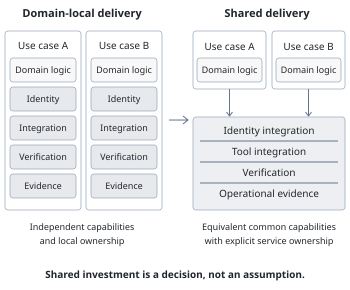
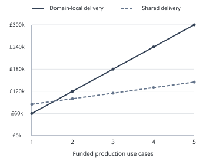
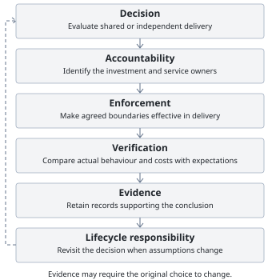

# Chapter 1

# The Case for a Shared Fabric

*Building an AI agent is an application engineering problem. Operating a portfolio of agents introduces an enterprise architecture problem.*

## Four successful pilots

The four AI pilots had all been described as successful.

At Meridian Financial, each team had demonstrated a working capability. Each could explain its technology choices, describe its intended business benefits and identify opportunities for further development.

Eleanor listened as the presentations concluded.

Then she asked a question that none of the demonstrations had been designed to answer.

“Which of these systems can show me who authorised the tools they use, who is responsible for the consequences of their actions, and what evidence tells us that their controls work?”

The answers were incomplete.

One team had documented its access permissions. Another had introduced an approval process. A third could produce execution records. The fourth had concentrated on improving the quality of its outputs.

Each team had addressed a different aspect of the problem. None could provide a complete account of how its capability would be governed and operated once the demonstration became a continuing business service.

Eleanor was not questioning whether the technology worked. She was questioning whether the organisation understood what it was taking responsibility for.

Individually, the initiatives appeared promising. Collectively, they revealed duplicated engineering effort, inconsistent controls and uncertainty about operational ownership.

The next decision was not which AI framework to adopt.

It was whether the enterprise had a repeated problem that justified shared investment in the first place.

*Meridian Financial is a fictional enterprise used throughout this book. The opening scene illustrates a hypothetical architectural problem rather than an observed production incident.*

## The successful pilot problem

A successful demonstration establishes that a capability is possible under particular conditions. It does not necessarily establish that the capability is suitable for continuing enterprise operation.

This distinction is familiar to anyone who has introduced a new technology into an established organisation. An application may work before its support arrangements exist. An integration may succeed before its security boundaries have been independently examined. A service may deliver value before its operating costs are understood.

AI agents introduce additional uncertainty into this familiar problem.

Unlike a conventional application following a largely predetermined execution path, an agent may interpret instructions, select tools, retrieve information and determine which action to attempt next. Its behaviour can depend on the information available at execution time, the capabilities exposed to it and the conditions under which those capabilities may be used.

An agent that performs well during a demonstration may encounter different information, permissions or operational conditions when deployed.

The resulting enterprise responsibility extends beyond determining whether the agent produces a useful response. The organisation must also establish whether the agent is permitted to perform the task, whether its information is appropriate for that task, and whether the consequences of its actions remain within acceptable boundaries.

Consider an agent introduced to assist with customer-service enquiries.

During a demonstration, it retrieves account information and prepares a response. The initial business case may concentrate on reduced handling time and improved consistency.

Once introduced into operational use, however, further questions arise.

Can the agent retrieve information belonging to a different customer? Does its access reflect the permissions of the employee on whose behalf it is working? Can it modify an account when the original request only permits investigation? What happens if two business systems disagree about the customer's eligibility? Who investigates an inappropriate action?

These are not primarily questions about the language model.

They concern the architecture surrounding the agent and the responsibilities of the organisation operating it.

A single application team can address these questions within its own solution. A carefully bounded agent, serving one business process and operating under established controls, may require no new enterprise platform.

The architectural problem changes when other teams begin addressing the same requirements independently.

## The accountability problem

Suppose five teams introduce agents into five different business processes.

Each team establishes its own approach to identity, tool access, information retrieval, evaluation and operational monitoring.

This may be entirely reasonable during early experimentation. Independent delivery allows teams to investigate different technologies, test business hypotheses and discover requirements without waiting for a central capability to be established.

The difficulty appears when these experiments become services on which the organisation depends.

The enterprise now needs to understand not only how each agent works, but how responsibility is distributed across the portfolio.

A business owner may assume that the application team controls the agent's authority. The application team may assume that the identity service establishes that authority. The identity team may correctly establish the identity of the requesting actor without knowing whether that actor is permitted to perform a particular business transaction.

All three teams may fulfil their local responsibilities while the end-to-end accountability problem remains unresolved.

Consider the distinction between identity and permission.

Knowing that an agent is acting on behalf of an authenticated employee does not establish that the employee has authorised every action the agent might propose. An agent permitted to investigate a refund request is not necessarily permitted to issue a refund.

The organisation needs an effective boundary between the proposed action and the business operation that would change external state.

That boundary must have an owner. Its behaviour must be defined. Its effectiveness must be examined. Its operation must produce sufficient information to establish what happened.

Without those responsibilities, the enterprise may possess several individually functional technologies without having a complete control over the resulting business action.

The same problem applies to information.

An agent may retrieve two contradictory records from authorised sources. Access to both records does not establish which is correct. A mechanism that allows the agent to retrieve information has fulfilled its access function, but the enterprise still needs to determine how conflicting information should be represented and resolved.

The distinction matters because a technically successful retrieval can lead to an inappropriate business decision.

An enterprise operating several agent-enabled services therefore needs answers to questions that extend beyond individual application design:

- Who owns the authority under which an agent acts?
- Where are consequential actions permitted or denied?
- Who determines whether contextual information is suitable for use?
- What evidence establishes that the required controls operate effectively?
- Who responds when the agent or its supporting capabilities fail?

These questions do not disappear when the organisation purchases a managed AI service. Nor are they resolved simply by standardising on a common development framework.

The underlying responsibility remains with the organisation, even when parts of the technology are supplied or operated by others.

## When repetition becomes an architectural concern

Repeated implementation is not automatically wasteful.

Two business domains may implement similar capabilities because their security requirements, operational characteristics or contractual obligations differ. A common implementation could introduce dependencies that neither domain would otherwise require.

An architecture that treats every repeated component as an opportunity for centralisation risks removing useful independence.

The relevant question is whether multiple use cases require sufficiently equivalent capabilities and control contracts for sharing to produce a defensible outcome.

Consider the following enterprise capabilities.

| Capability | Potential repeated requirement | Question that determines whether sharing is appropriate |
|---|---|---|
| Identity integration | Establish authenticated actors and delegated authority | Can the same authority contract satisfy each use case? |
| Tool integration | Connect agents to approved business services | Are the access and action requirements sufficiently equivalent? |
| Verification | Assess behaviour before release and during operation | Can common verification services support different domain-specific assertions? |
| Operational evidence | Record decisions, actions and outcomes | Can shared evidence services preserve confidentiality and ownership requirements? |
| Execution infrastructure | Provide bounded environments for agent workloads | Are the isolation, availability and resource requirements compatible? |

Two applications using the same technology do not necessarily have the same architectural requirements.

A customer-service assistant and a financial transaction agent might both use a language model. That does not establish that they should share an execution environment, an identity model or the same permitted tools.

Conversely, two applications using different development frameworks may still require equivalent identity integration, action authorisation and operational evidence.

In that situation, the potential opportunity lies in sharing the required capabilities, not necessarily the application technology.

This is an important distinction for enterprise architects. Technology standardisation and architectural reuse are related decisions, but they are not interchangeable.

A common technology may simplify procurement and support. A common control contract may establish consistent requirements across several implementations. A shared operational service may reduce duplication where those requirements can be fulfilled safely through the same capability.

Each choice has different consequences.

The architecture should establish which form of consistency is necessary before deciding how it will be delivered.

## What a shared Fabric means

This book uses the term *Fabric* to describe an organised set of reusable agent capabilities and cross-cutting control responsibilities that support multiple enterprise use cases.

A shared Fabric is the decision to provide some of those capabilities through common enterprise services rather than requiring each use case to establish and operate them independently.

It is not necessarily a single platform, product, deployment environment or central engineering team.

An organisation might provide shared identity integration and action authorisation while allowing individual business domains to maintain separate execution environments. Another might operate common evaluation and evidence services while leaving tool integration with the teams that own the relevant business systems.

The appropriate arrangement depends on the architectural requirements and the responsibilities the organisation is prepared to assume.

*Figure 1-1. Domain-local delivery compared with selective capability sharing.*

*Alternative text: Two use cases initially provide their own identity, integration, verification and evidence capabilities. In the shared alternative, equivalent capabilities are provided through a common service while domain-specific business logic remains local.*

Figure 1-1 illustrates the difference between independent delivery and selective sharing. It is not a prescribed physical architecture.

The right-hand arrangement introduces a new responsibility: someone must provide, maintain and support the shared capabilities on which the use cases depend.

If a shared service becomes unavailable, several business processes may be affected. If its contract changes, multiple teams may need to adapt. If its security boundary fails, the consequences may extend beyond an individual use case.

Sharing therefore exchanges some forms of duplication for new forms of dependency.

That exchange may be worthwhile. It may also be inappropriate.

The architectural decision is to establish which outcome is preferable under the enterprise's actual conditions.

## The economics of shared capabilities

A shared Fabric creates costs before it creates benefits.

Engineering teams must establish the common capabilities, define their interfaces, provide operational support and accommodate requirements from multiple consumers.

Even if the first use case adopts the shared service successfully, the investment may remain unjustified until sufficient additional demand exists.

This creates a familiar economic problem: the relationship between fixed platform expenditure and the incremental cost of supporting additional use cases.

Consider a hypothetical enterprise with two funded production use cases requiring equivalent identity integration, tool connectivity, verification and operational evidence.

Independent delivery is estimated to cost £60,000 per use case during the first year.

A shared alternative requires £70,000 to establish and operate the common service, together with £15,000 of incremental onboarding expenditure for each use case.

For this simplified comparison, assume that the options provide equivalent required capabilities and that costs common to both alternatives have been excluded.

The purpose is to evaluate the incremental architecture choice, not to calculate the complete business cost of introducing AI.

*Table 1-1. Illustrative first-year cost comparison*

| Cost component | Domain-local delivery | Shared delivery |
|---|---:|---:|
| Shared service cost | £0 | £70,000 |
| Use case A | £60,000 | £15,000 |
| Use case B | £60,000 | £15,000 |
| **Total first-year cost** | **£120,000** | **£100,000** |

The illustrative difference is £20,000 in favour of shared delivery.

This is an estimated opportunity, not an achieved saving.

The arithmetic can be expressed as:

\[
C_{\text{local}}(n)=60{,}000n
\]

\[
C_{\text{shared}}(n)=70{,}000+15{,}000n
\]

where \(n\) is the number of equivalent funded production use cases.

The comparison changes as the number of use cases changes.

*Figure 1-2. Illustrative relationship between repeated demand and first-year delivery costs.*

For one use case, the shared alternative costs £85,000 compared with £60,000 for independent delivery.

The additional £25,000 expenditure would need justification that is absent from this scenario.

For two use cases, the illustrative economic relationship reverses.

Under these assumptions, the shared alternative becomes financially attractive because the additional use case can be supported without reproducing the entire capability.

The theoretical break-even point occurs when:

\[
60{,}000n=70{,}000+15{,}000n
\]

\[
n=\frac{70{,}000}{45{,}000}\approx1.56
\]

Since the scenario concerns whole use cases, the first integer demand level supporting the illustrative shared-cost case is two.

The calculation is useful because it exposes the assumptions behind the investment decision. It is also incomplete.

A platform's incremental cost may increase as additional consumers introduce different availability, isolation or support requirements. New consumers may require changes to shared interfaces. The platform team may need additional operational capacity.

The apparent cost advantage could disappear.

For example, if the shared arrangement requires an additional £30,000 of previously excluded transition expenditure, the two-use-case comparison changes from £100,000 to £130,000.

Independent delivery would then be £10,000 less expensive during the first year.

A defensible investment assessment must therefore consider more than the initial engineering estimate.

It should examine the costs associated with establishing, integrating, operating, securing, changing and eventually replacing the capability.

Existing enterprise services must also be included in the comparison. An organisation may already possess identity, policy enforcement or observability capabilities that satisfy part of the requirement. Ignoring those assets could produce an artificially favourable case for building something new.

The economic model presented here does not capture every financial consideration. Its value is to establish the relationship between repeated demand, shared expenditure and the assumptions that must be verified.

Chapter 8 develops the relationship between model strategy and unit economics. Chapter 41 examines how to turn these considerations into a formal business case.

For the present decision, the important principle is that projected reuse is not the same as demonstrated economic benefit.

## When not to build a Fabric

A shared platform can become an expensive answer to a problem the organisation does not yet have.

An enterprise may possess several AI demonstrations but only one funded production use case. It may anticipate significant future adoption without having confirmed business demand. It may identify apparently common capabilities whose actual control requirements are materially different.

In these circumstances, shared investment introduces continuing expenditure on the assumption that future consumers will eventually justify it.

That assumption deserves explicit examination.

The default position adopted in this book is established by the first decision in the Decision Atlas.

> D-01 · Adopt a shared Fabric
>
> **Default**
>
> Default to domain-local delivery until at least two funded production use cases need the same control contracts and a positive shared-cost case is evidenced.
>
> **Trade-off**
>
> This buys coherent controls and reuse at the cost of platform operations.
>
> **Reversibility**
>
> Two-way door.
>
> Source: Decision Atlas, D-01. The complete decision appears in Chapter 23.

The default places the burden of justification on shared investment rather than requiring teams to defend their independence.

It does not prohibit standardisation. An enterprise can establish common security requirements, approved integration patterns and consistent evidence expectations without immediately establishing a shared runtime service.

It also does not prohibit the development of a common capability that is required for other independently justified enterprise purposes.

The decision concerns whether repeated agent use-case demand justifies establishing and operating a shared Fabric.

Three conditions are particularly important.

First, the demand must be real. A demonstration, expression of interest or speculative future initiative should not automatically be counted as a funded production consumer.

Second, the relevant control contracts must be equivalent. Sharing a technology does not establish that the associated security, authority or operational requirements are compatible.

Third, the economic comparison must support the proposed investment. A shared service is not justified merely because duplicate implementations appear architecturally undesirable.

There are circumstances in which independent delivery remains appropriate despite apparent technical overlap.

A contractual segregation requirement may prevent two workloads from sharing particular services. A latency-sensitive use case may require an independently managed execution boundary. An isolated business capability may have no reasonable expectation of additional consumers.

The enterprise should also consider whether shared delivery would concentrate operational dependency beyond what its service owners can support.

A shared capability that cannot meet the needs of its consumers does not become a better architectural choice merely because its nominal cost is lower.

### The alternative: domain-local delivery

Domain-local delivery does not mean uncontrolled delivery.

The application team remains responsible for meeting applicable enterprise security, operational and verification requirements. It may adopt common architectural patterns, use existing approved services and provide evidence against enterprise requirements.

The distinction is that the organisation does not establish a new shared Fabric merely to support that isolated requirement.

In the one-use-case economic scenario, the opportunity brief would recommend domain-local delivery. The enterprise would retain the assumptions supporting that decision and identify the circumstances under which it should be reconsidered.

This might occur when another funded use case needs equivalent capabilities or when existing local delivery costs materially change.

The organisation has not rejected platform engineering. It has chosen not to make a particular shared investment under the current conditions.

Chapter 4 examines the conditions that justify retaining that position.

## From architectural decision to evidence

The investment example establishes a choice between two alternatives.

It also reveals the limits of an architecture decision recorded only as a recommendation.

Suppose an enterprise architecture board approves the shared alternative because the illustrative comparison identifies a £20,000 potential saving.

Six months later, the original business domains have different requirements. The platform team is supporting integrations that were not included in the initial estimate. Onboarding takes longer than anticipated. Responsibility for certain operational failures remains disputed.

The original decision record states why sharing was selected, but it does not necessarily establish whether the conditions that justified the investment still exist.

An architectural decision becomes more useful when its assumptions, accountability, implementation consequences and expected evidence are connected from the beginning.

This book calls that approach **decision-to-evidence engineering**.

It extends the practical value of established architectural decision records by consistently connecting a choice to the responsibilities and mechanisms required to make it effective, the activities needed to verify its outcome, and the evidence that supports continuing reliance on it.

The approach does not replace architecture decision records, security engineering, service ownership or operational assurance. It establishes a consistent relationship between them.

*Figure 1-3. Decision-to-evidence engineering applied to shared capability investment.*

*Alternative text: An architectural decision identifies accountable owners, effective implementation boundaries, verification activities and supporting evidence. A feedback path returns the resulting observations to the original decision when circumstances change.*

Figure 1-3 illustrates the method through the investment problem introduced in this chapter.

### Decision

The organisation identifies the alternatives and establishes the conditions under which one is preferable.

In this case, the alternatives are domain-local delivery and shared delivery of equivalent capabilities.

The recommendation must distinguish the available evidence from assumptions that still require investigation.

### Accountability

The investment sponsor accepts responsibility for the funding decision.

A designated platform service owner must accept responsibility for providing and operating the shared capability. Business domains retain responsibility for the outcomes of their individual use cases.

Sharing an identity integration service, for example, does not transfer ownership of every business permission decision to the team operating that service.

### Enforcement

The decision must affect implementation and operation.

If shared investment is authorised for particular capabilities and consumers, the implementation should reflect those boundaries. Unapproved expansion should not silently become part of the platform's continuing obligations.

At this strategic level, enforcement may involve funding conditions, service acceptance requirements and agreed delivery boundaries.

Later architectural decisions introduce runtime enforcement mechanisms, such as preventing an agent from executing an unauthorised external action.

The mechanism differs according to the decision. The obligation to make the decision effective remains.

### Verification

The organisation defines how it will establish whether the expected outcome has been achieved.

For shared investment, this may involve comparing actual onboarding effort, service expenditure and control effectiveness against the assumptions used to approve the investment.

A successfully deployed shared service is not sufficient evidence that the economic case was correct.

### Evidence

The organisation retains the records needed to explain the conclusion.

Relevant evidence might include confirmed production demand, equivalent service requirements, cost comparisons, service ownership acceptance and actual operational measurements.

The existence of an architecture approval document establishes that a decision was recorded. It does not, by itself, establish that the expected benefits were realised.

### Lifecycle responsibility

The decision must be reconsidered when its supporting assumptions change.

If a funded consumer withdraws, operational costs increase materially or segregation requirements change, the service owner and investment sponsor should examine whether the shared arrangement remains appropriate.

Reconsideration does not necessarily require immediate replacement. It requires a defensible decision about the consequences of changed circumstances.

This completes the relationship between an architectural choice and the evidence needed to support its continuing validity.

## Worked example: the Fabric Opportunity Brief

An enterprise architect does not need to produce a comprehensive reference architecture to establish whether a shared Fabric merits further investigation.

The initial artefact should be proportionate to the decision being made.

A Fabric Opportunity Brief provides a concise description of the problem, the alternatives, the assumptions requiring evidence and the responsibility for further action.

The brief is not a substitute for a detailed investment appraisal or the formal architecture decision record required by D-01. It provides the information needed to determine whether that further work is justified.

The following completed example applies the hypothetical cost comparison developed earlier.

### Fabric Opportunity Brief

*Illustrative completed example · Initial architecture decision*

**Business problem**

Two hypothetical funded production use cases require equivalent capabilities for identity integration, approved tool connectivity, verification and operational evidence.

Independent implementation could create duplicated expenditure and inconsistent support arrangements.

**Decision under consideration**

Determine whether the identified capabilities should remain domain-local or be provided through a shared service.

**Alternatives**

| Option | Description | First-year cost |
|---|---|---:|
| A | Independent delivery | £120,000 |
| B | Shared delivery of equivalent capabilities | £100,000 |

*All costs and use-case conditions are hypothetical.*

**Indicative economic outcome**

**£20,000**

Potential first-year cost difference in favour of shared delivery, before verification of the complete cost assumptions.

**Required ownership**

| Responsibility | Accountable role |
|---|---|
| Funding decision | Investment sponsor |
| Architecture recommendation | Enterprise architecture lead |
| Shared service delivery and operation | Designated platform service owner |
| Individual business outcomes | Respective business domain owners |
| Control requirements | Relevant security and architecture authorities |

*Roles are proposed for this example. No actual appointments or approvals are claimed.*

**Material trade-offs**

Shared delivery may reduce duplicated engineering and establish more consistent control contracts.

It also introduces common operational dependencies, continuing platform expenditure and the need to manage requirements from multiple consumers.

**Evidence required before investment approval**

| Requirement | Expected evidence |
|---|---|
| Funded demand | Confirmed production use-case commitments |
| Equivalent requirements | Comparison of the required control contracts |
| Economic justification | Like-for-like cost assessment |
| Operational feasibility | Accepted service responsibilities and requirements |
| Security compatibility | Assessment of relevant isolation and segregation constraints |
| Existing service reuse | Assessment of capabilities already available within the enterprise |

**Provisional decision**

Evaluate shared delivery.

The illustrative economic comparison supports further investigation. It does not establish that the investment has been approved or that the expected savings have been achieved.

Until the conditions in D-01 are evidenced, domain-local delivery remains the default.

**Verification after an approved implementation**

Compare actual onboarding expenditure, continuing service costs, operational responsibilities and control effectiveness against the conditions supporting the investment.

**Reconsideration conditions**

Reopen the decision if funded demand changes, the use cases develop materially different requirements, segregation obligations change, operating costs exceed the supporting assumptions or the service owner cannot sustain the required capability.

**Alternative outcome**

If only one funded use case exists, independent delivery costs £60,000 compared with £85,000 for shared delivery.

Under these illustrative conditions, retain domain-local delivery and reconsider the shared option when additional justified demand emerges.

**Resulting artefact**

Fabric Opportunity Brief, providing input to the formal `fabric-adoption-adr.md` required by D-01.

*Evidence classification: hypothetical teaching example. No actual enterprise investment, production deployment, approval, control result or financial saving is claimed.*

---

The brief illustrates the distinction between identifying a potentially favourable investment and establishing an approved architectural decision.

It makes the alternatives explicit. It identifies the roles responsible for the outcome. It states which assumptions require evidence and establishes how the original choice could later be challenged.

Most importantly, it allows the enterprise to reach either conclusion without treating one as an architectural failure.

The purpose of the method is not to promote shared platforms. It is to improve the quality of the decision.

## Why this decision matters beyond investment

The shared Fabric decision is the first example in the book because it establishes a principle that applies to the architectural choices that follow.

An enterprise may decide that agents should possess bounded delegated authority. The value of that decision depends on whether an effective mechanism prevents actions outside that authority and whether the organisation can establish that the mechanism works.

An enterprise may decide that conflicting contextual information should remain unresolved until an accountable authority can reconcile it. The value of that decision depends on whether the supporting mechanisms preserve the disagreement rather than allowing an agent to silently convert uncertainty into an apparent fact.

An enterprise may decide that increasing agent autonomy requires evidence of appropriate behaviour. The value of that decision depends on whether promotion is genuinely withheld when the required verification conditions are not satisfied.

Each example concerns a different architectural responsibility.

Yet the same underlying questions remain.

What has the organisation chosen? Who accepts responsibility for the consequences? Where does the decision become effective? How will its effectiveness be established? What evidence supports the conclusion? When must the decision be reconsidered?

The Decision Atlas develops these questions through thirty consequential enterprise architecture decisions.

It provides recommended defaults, their rationale, the associated trade-offs, circumstances in which alternatives are appropriate and the artefacts that should result.

A default is a starting position supported by stated reasoning, not an instruction to disregard the conditions of a particular enterprise.

The architectural mechanisms described in the subsequent chapters explain how these decisions can become effective within agent systems.

The operational and lifecycle material examines how their consequences are owned and how their continued suitability can be established.

Together, these perspectives connect the design of an agent capability to the responsibilities of the organisation introducing it.

## Conclusion

The introduction of AI agents does not, by itself, justify the creation of a new enterprise platform.

A shared Fabric becomes a defensible architectural choice when multiple funded production use cases need equivalent control contracts, when shared delivery offers a positive economic case and when the organisation can accept the operational responsibilities that follow.

Without those conditions, independent delivery may be the more appropriate choice.

This is not an argument against reusable capabilities. It is an argument for establishing their justification before making the investment.

The same discipline applies to the other architectural decisions developed throughout this book.

Technology can make an action possible without establishing whether it is appropriate. A control can be documented without being effective. A system can produce evidence without that evidence supporting the conclusion being drawn from it.

Architecture must address these distinctions.

The task of the enterprise architect is therefore not simply to select technologies or define components. It is to establish choices whose consequences can be understood, whose responsibilities can be assigned and whose effectiveness can be examined.

A shared Fabric is one such choice.

Its justification begins with the enterprise problem, not with the availability of technology that makes sharing possible.

The next chapter examines the nature of agent capabilities themselves, distinguishing what an agent can do from what the organisation should permit it to do. That distinction establishes the foundation for assessing autonomy and risk before making further architectural commitments.

## See also

| Chapter | Related subject |
|---|---|
| Chapter 2 — Agent Capability, Autonomy and Risk | Distinguishing capability from permitted action |
| Chapter 4 — When Not to Build a Fabric | Conditions favouring independent delivery |
| Chapter 5 — Build, Buy, Embed or Partner | Alternative approaches to capability acquisition |
| Chapter 8 — Model Strategy and Unit Economics | Economic considerations in AI service design |
| Chapter 23 — The Fabric Decision Atlas | D-01 and related architectural decisions |
| Chapter 24 — Stage 0: Strategic Intent | Establishing demand and authorising further investigation |
| Chapter 41 — P1: Build the Business Case | Developing a formal investment appraisal |

---

*End of Chapter 1.*
