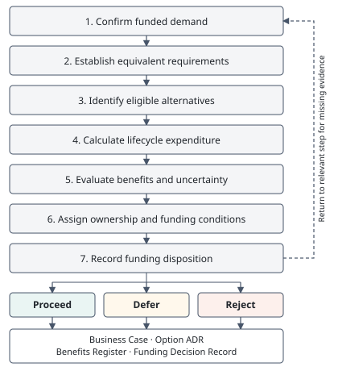
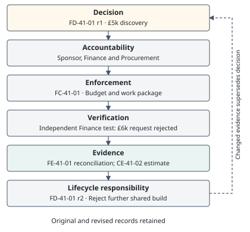

# Chapter 41
## P1: Build the Business Case

**When to use.** Appraise investment in shared Fabric capabilities or further funding for an existing service. Compare equivalent delivery options and record a funding disposition.

**Preconditions.**
- A Fabric Opportunity Brief or equivalent demand inventory identifies business sponsors, outcomes and current alternatives.
- Architecture, security, procurement and Finance representatives can challenge assumptions.
- A designated investment authority can accept or decline expenditure.

**War story.** At a fictional Meridian Financial investment meeting, Maya Shah presented a request for shared agent services. The proposal included a common identity integration, a controlled tool interface and a service for evaluating agents before release. Four pilots appeared on the demand slide. Eleanor Price asked how many had funded production commitments and how much each would cost if the shared service were not built.

Maya had estimates for two teams. The other two had demonstrated their pilots but had no production budgets. The proposal assumed that all four would consume the service. Finance had not included migration work or continuing support in the comparison. The security architect could describe the intended controls but had not agreed which tests the investment would pay for.

Eleanor returned the proposal. She did not dispute the need for the controls. She declined to commit funds against an unverified consumer count, an incomplete cost comparison and an unassigned operating obligation. Maya arranged a joint appraisal with the domain sponsors and Finance before requesting another decision. The team would have to establish the conditions under which shared delivery was worth funding, and record what would happen if those conditions ceased to hold. The seven steps below provide that appraisal.

*The scene and all investment examples in this chapter are hypothetical teaching material, separate from the frozen Meridian refund evidence. No actual expenditure, funding approval or deployment is reported.*

### Executive investment decision brief

| Decision requested | Bounded discovery, maximum £5,000 |
|---|---|
| Purpose | Establish whether shared identity, action admission, verification and evidence services justify investment for two funded workloads. |
| Economics | Three-year local estimate £240k; shared £232k; potential cost avoidance £8k. |
| Conditions | Confirm demand, equivalent controls, sourcing costs and continuing service ownership. |
| Exclusions | No build, production release or business-action authority. |
| Review | Investment committee in 30 days; reconsider if the cost case or essential controls cannot be established. |

Fund evidence before funding commitment. The following appraisal explains how to reach this proposed disposition and how to change it when the evidence changes.

*Figure 41-1. Execute the seven steps; return to the relevant step when evidence is insufficient.*

### Steps

#### 1. Confirm funded demand

Action: Count funded production use cases. Owner: domain sponsors and enterprise architect. Input: opportunity brief and budget commitments. Output: demand register. Time: 30–60 minutes once evidence is available.

Apply D-01, Adopt a shared Fabric.

> Default to domain-local delivery until at least two funded production use cases need the same control contracts and a positive shared-cost case is evidenced.

Record each sponsor, budget commitment, release target, task volume, shared dependency and commitment expiry. Reference the approved workload case, including its outcome baseline and the current-process alternative. Cheaper delivery cannot establish that the workload itself merits investment.

Retail refund-review preparation and insurance policy-document review have assumed funded production commitments in this example. Wealth research and employee assistance remain unfunded pilots. Count two, not four. Retail review and preparation do not authorise payment; insurance review is an additional hypothetical workload, not a fixture event. Remove expired commitments and recalculate.

#### 2. Establish equivalent requirements

Action: Compare control contracts. Owner: enterprise architect with security and domain specialists. Input: funded demand and requirements. Output: agreed comparison. Time: 1–2 hours.

Both workloads require bounded delegated identity, tenant-specific retrieval admission, typed tool requests, controlled action admission, verification before release and attributable evidence. The illustrative service targets are 99.9% monthly availability, four-hour recovery and 90-day evidence retention subject to lawful holds and deletion obligations. These are case assumptions, not Fabric-wide defaults.

Share contracts, not credentials, records or business authority. Insurance records remain inaccessible to the retail agent. Separate or price incompatible isolation and retention requirements before counting consumers.

Specify negative retrieval and action tests and mandatory behavioural assertions before implementation. An unauthorised retrieval must fail; an unauthorised mutable action must not reach its target; a failed mandatory assertion must block release. Domain owners define business-success assertions independently.

#### 3. Identify eligible alternatives

Action: Screen delivery and sourcing options. Owner: enterprise architect, procurement and platform leads. Input: requirements, service inventory and supplier evidence. Output: shortlist and exclusions. Time: 1–2 hours, excluding supplier investigation.

Apply D-02, Select build, buy, embed or partner.

> Default to embedding bounded SaaS-native tasks and extending governed shared integration only where cross-system control warrants it.

| Option | Disposition for the cross-system workloads |
|---|---|
| Domain-local | Eligible comparator with equivalent controls. |
| Reuse approved services | Identity and telemetry reuse assumed in both estimates; remaining admission and verification obligations require delivery. |
| SaaS embedding | Retain for bounded native tasks; insufficient alone for stipulated cross-system requirements. |
| Managed purchase | Defer selection pending price, authority, isolation, evidence export and exit terms. |
| Selective shared build | Conditional candidate; retain domain adapters and business decisions. |
| Partner | Defer selection pending priced support, access, ownership and exit commitments. |

Unknown prices are not zero costs. Record missing evidence, owner and due date. Do not claim the candidate has beaten an unpriced supplier; reopen sourcing if comparable evidence changes.

#### 4. Calculate lifecycle expenditure

Action: Compare expenditure. Owner: Finance and platform lead. Input: eligible options and assumptions. Output: financial model. Time: 2–4 hours after estimates arrive.

Use Chapter 1's £60k per local case, £70k fixed shared expenditure and £15k per shared consumer in year one. The breakdown is hypothetical, in £ thousands at constant prices, excluding VAT and financing effects.

| Year-one cost | Local per case | Shared fixed | Shared per case |
|---|---:|---:|---:|
| Integration, control build and testing | 32 | 40 | 5 |
| Transition and training | 6 | 5 | 2 |
| Support, evaluation and assurance | 12 | 15 | 3 |
| Runtime, tools and models | 10 | 10 | 5 |
| Total | 60 | 70 | 15 |

Compare equivalent task volumes and controls. Fixed runtime covers common control-service compute; incremental runtime covers workload consumption. Price differences in retries, tools and evaluation. Do not count migration twice.

For n eligible consumers and additional transition expenditure T, local L = 60n; shared S = 70 + 15n + T. Strict first-year cost advantage requires 45n > 70 + T, in addition to D-01's other conditions.

Years two and three each assume £26k per local consumer or £30k fixed plus £13k per shared consumer. Year-three exit costs are £8k per local consumer or £12k fixed plus £4k per shared consumer, covering revocation, evidence export, data disposition and migration support.

| Period (£k) | Two local | Two shared |
|---|---:|---:|
| Year 1 | 120 | 100 |
| Year 2 | 52 | 56 |
| Year 3 including exit | 68 | 76 |
| Total | 240 | 232 |

The £20k first-year cost advantage narrows to £8k over three years. At an illustrative 5% annual discount rate with year-end flows, present expenditure is £220.2k local and £211.7k shared. Use Finance-approved timing, discount, tax and capitalisation rules. These are estimates of expenditure, not realised savings or ROI.

#### 5. Evaluate benefits and uncertainty

Action: Challenge assumptions and define outcomes. Owner: sponsor, Finance and domain owners. Input: model and expected benefits. Output: sensitivity analysis and benefits register. Time: 1–2 hours.

| First-year scenario (£k) | Local | Shared | Indication |
|---|---:|---:|---|
| One funded case | 60 | 85 | Retain local |
| Two funded cases | 120 | 100 | Progress appraisal |
| Two, extra transition 30 | 120 | 130 | Retain local |
| Three equivalent cases | 180 | 115 | Progress appraisal |
| Three incompatible cases | Not comparable | Not comparable | Defer; redefine scope |

The original three-year advantage disappears at £8k additional transition cost. Do not confuse first-year economics with whole-life economics.

A manufacturing enterprise with incompatible contractual segregation requirements defers sharing until scope and cost are established. An HR team with one funded SaaS-native document-assistance task rejects new shared investment and evaluates embedding. These are hypothetical alternatives, not Meridian events.

Measure onboarding effort before build; a proposed 20% reduction is a target. Domain owners establish correctness and cycle-time baselines. Finance distinguishes cash-releasing savings from released capacity. Do not monetise prevented harm without a defensible loss model or trade away mandatory controls for financial advantage.

#### 6. Assign ownership and funding conditions

Action: Assign responsibilities and conditions. Owner: sponsor with platform, domain, security and Finance owners. Input: options, costs, risks and benefits. Output: operating commitments and evidence schedule. Time: 30–60 minutes.

Apply D-03, Choose a central, federated or hybrid model.

> Default to a hybrid model with central control contracts and domain-owned use cases.

The platform owner accepts support, availability and common-service cost obligations; domain owners retain correctness and outcomes. The Governance Control Plane's accountable policy authority sets requirements and exceptions. The Gateway enforces applicable action admission; Verification assesses assertions; Observability records evidence. Escalate unresolved ownership to the sponsor.

Approval is not transferable.

| Authorisation | Accountable authority | Supporting evidence |
|---|---|---|
| Funding: commit resources | Investment authority | Funding Decision Record |
| Architecture: accept design | Designated architecture/control authorities | Approved baseline and ADRs |
| Release: admit candidate | Designated release authority | Verification and release report |
| Runtime action: permit specific action | Applicable business/policy authority; Gateway enforcement | Action-admission evidence |

These distinctions do not prescribe four sequential gates. Funding refund review grants no refund execution authority; even release approval does not extend delegation.

Apply D-26, Allocate cost and budgets.

> Default to tenant, use-case and trajectory-level showback based on cost per successful task, with budgets and invoice reconciliation.

Forecast 20,000 retail and 30,000 insurance successful tasks. Allocate £70k common expenditure equally by assumed reserved capacity and £15k direct expenditure per consumer. Each receives £50k: £2.50 retail and £1.67 insurance per successful task; portfolio £2.00. Include failed attempts and retries in cost; count success only under domain assertions. With zero successes report expenditure and an undefined ratio. Reconcile invoices and labour monthly; expose unallocated cost.

Specify the evidence required before implementation.

| Condition | Acceptance evidence | Owner / when |
|---|---|---|
| Demand and economics | Two commitments, priced comparable options, positive shared-cost case | Sponsor/Finance, before build |
| Isolation and authority | Negative retrieval/action tests, no unauthorised target call | Security, before release |
| Behaviour | Mandatory assertions pass, independent release report | Verification/domain, before release |
| Service | Accepted on-call ownership, four-hour recovery test, availability measured against 99.9% target | Platform, before release and monthly |
| Economics and exit | Reconciled trajectory/use-case/tenant costs; export, revocation and data disposition rehearsal | FinOps monthly; service/data owners before production commitment |

A test specification is not a test result. A Gateway denial does not excuse a failed behavioural assertion.

**Funding enforcement.** A documented condition is not an enforced condition. Translate funding limits into operating controls.

| Condition | Operating point | Evidence to retain |
|---|---|---|
| FC-41-01: £5k discovery only | Finance budget reservation; approved work package; delegated purchase approval | Commitment check, approved scope, ledger |
| FC-41-02: no build, expiry after 30 days | Work authorisation and procurement review; expired authority cannot support new commitment | Scope/expiry check and renewed decision, if any |

Count incurred expenditure plus outstanding commitments, without counting an invoice and its settled reservation twice. Include internal labour and external purchases. Finance owns reconciliation; Procurement checks delegated authority. Where controls are manual, identify the reviewer and retain the signed check.

#### 7. Record the funding disposition

Action: Submit appraisal and conditions. Owner: investment authority. Input: comparison and evidence schedule. Output: funding decision record. Time: 30–60 minutes, excluding approvals.

Proceed defines authorised scope and limit. Defer names missing evidence, owner and review date. Reject states the reason and remaining alternative.

In the hypothetical committee decision FD-41-01 r1, Eleanor authorises £5k discovery for 30 days, within the £40k shared build-and-test estimate. The remaining £95k first-year forecast is unauthorised. Discovery purchases information, not implementation.

*Figure 41-2. One funding decision remains traceable through enforcement and reconsideration.*

| Responsibility | Worked trace (hypothetical) |
|---|---|
| Decision | FD-41-01 r1: £5k discovery ceiling. |
| Accountability | Sponsor owns disposition; Finance controls spending; Procurement checks authority. |
| Enforcement | FC-41-01: budget and work-package checks before commitment. |
| Verification | Independent Finance reviewer tests a proposed £6k commitment before any spend; it is rejected before booking. Reconciles discovery expenditure at closure. |
| Evidence | FE-41-01 records rejection, zero commitment from test, £5k separately incurred discovery and no outstanding commitments. CE-41-02 records additional transition estimate. |
| Lifecycle responsibility | FD-41-01 r2 supersedes r1 for future commitment, retaining original evidence. |

The rejected request tests the financial boundary; it is not payment or runtime evidence. The technical release tests remain pending. All teaching IDs in this example are local, not Meridian fixture records.

**Reconsideration.** Discovery identifies £20k additional migration and parallel-running expenditure (CE-41-02). Assume £5k discovery has been fully spent, is unrecoverable and produces no transferable local cost reduction. Both delivery options remain equivalent for approved workloads; no other sunk costs or commitments exist. Other sourcing candidates remain unselected pending comparable evidence.

| Comparison (£k) | Local | Shared |
|---|---:|---:|
| Original three-year forecast | 240 | 232 |
| Additional transition | 0 | 20 |
| Revised delivery estimate | 240 | 252 |
| Already incurred within estimate | 0 | 5 |
| Remaining expenditure | 240 | 247 |
| Total programme expenditure including sunk discovery | 245 | 252 |

At the review date, compare £240k with £247k, not £240k with £252k. The £5k already spent appears in either programme outcome. The remaining-cost switching value is £13k additional transition expenditure, rather than the original £8k whole-life threshold. Local delivery now costs £7k less prospectively.

Eleanor rejects further shared build and closes discovery. The local candidate returns for separate investment approval; no local budget, architecture, release or action authority is granted by this disposition. If material evidence were missing for this comparison, defer rather than claim a final sourcing selection.

A business case can expire. Retain the original forecast, the evidence that changed it and the superseding decision. Reopen continuing investments on changed demand, cost, control or ownership; compare remaining avoidable costs and exit obligations rather than automatically shut down a service.

### The worked records

Keep each record's original revision. The following entries show the minimum connected content; the companion specimens and blank templates use the same fields.

| Record | Revision 1: discovery | Revision 2: reconsideration |
|---|---|---|
| BC-41-01 Business Case | Two funded consumers; common contracts; £240k/£232k; bounded discovery; sponsor accountable | CE-41-02: £240k/£247k remaining; £5k sunk; local candidate referred for approval |
| ADR-41-01 Option ADR | D-01/02/03/26; selective shared integration candidate; supplier terms pending; domain adapters and exportable evidence | Shared candidate rejected for current costs; local preferred among priced eligible options; reopen on new sourcing, demand or control evidence |
| BR-41-01 Benefits Register | £8k forecast avoidance; onboarding target −20%, baseline pending; £2.50/£1.67 task forecasts; mandatory controls and business assertions pending | Original cost hypothesis withdrawn; £7k prospective local advantage forecast; shared onboarding and unit-cost targets not applicable to discontinued candidate; no achieved benefits |
| FD-41-01 Funding Decision Record | Committee, £5k discovery, 30 days; FC-41-01/02; no build or release; review by Finance and sponsor | FE-41-01 and CE-41-02; reject further shared build; close work package; no new commitment; supersedes r1 prospectively |

Finance owns cost measures and reviews quarterly; platform owner measures equivalent onboarding person-hours at each onboarding; Security and Verification owners assess mandatory controls before release; FinOps reconciles successful-task economics monthly; domain owners measure correctness and cycle time from sampled outcomes monthly. Record baselines before build and domain targets before release. All measures remain forecasts, pending or withdrawn in this case.

The combined ADR does not replace fabric-adoption-adr.md, sourcing-options-adr.md, operating-model-adr.md or cost-allocation-policy.xlsx. Preserve the individual Atlas obligations if progressing design. Record risk treatments for demand loss, incompatible segregation, supplier lock-in, incomplete costs and missing ownership in the relevant record; no funding authority overrides mandatory controls.

### Failure modes

- Counted pilots: remove unsupported demand.
- False equivalence: split scope or price requirements.
- Predetermined sourcing: reopen the shortlist.
- Omitted support or exit: compare a common horizon.
- Unsupported ROI: establish a baseline and measurement method.
- Missing owner or unenforced funding condition: withhold progression.
- Approval substitution: retain distinct authorities.
- Changed assumptions: preserve history and record reconsideration.

### The artefact you now have

A Business Case, Option ADR, Benefits Register and Funding Decision Record, with evidence references, accountable owners, original and superseding revisions.

### The decision you must record

Record proceed, defer or reject, authorised scope, accountable authority, enforceable conditions and the evidence that will cause reconsideration.

### See also

Chapters 1, 4, 5, 6, 8, 20, 23, 24, 38 and 42; D-01, D-02, D-03 and D-26.
