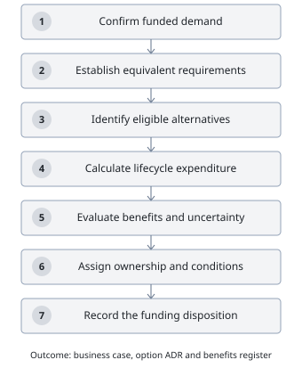
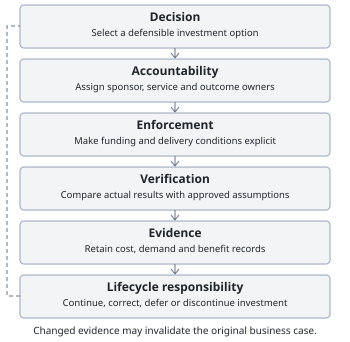

# Chapter 41
## P1: Build the Business Case

**When to use.** Use this playbook when business sponsors request investment in a shared Fabric capability, or when an existing service needs further funding. The appraisal compares delivery and sourcing options under equivalent control contracts. It ends with a funding disposition, not permission to deploy an agent. A case for rejecting shared investment is as useful as a case for approving it.

**Preconditions.**
- A Fabric Opportunity Brief or equivalent demand inventory exists.
- Business sponsors can identify funded use cases, intended outcomes and current alternatives.
- Architecture, security, procurement and Finance representatives can challenge assumptions.
- A designated investment authority can accept or decline expenditure.

**War story.** At a fictional Meridian Financial investment meeting, Maya Shah presented a request for shared agent services. The proposal included a common identity integration, a controlled tool interface and a service for evaluating agents before release. Four pilots appeared on the demand slide. Eleanor Price asked how many had funded production commitments and how much each would cost if the shared service were not built.

Maya had estimates for two teams. The other two had demonstrated their pilots but had no production budgets. The proposal assumed that all four would consume the service. Finance had not included migration work or continuing support in the comparison. The security architect could describe the intended controls but had not agreed which tests the investment would pay for.

Eleanor returned the proposal. She did not dispute the need for the controls. She declined to commit funds against an unverified consumer count, an incomplete cost comparison and an unassigned operating obligation. Maya arranged a joint appraisal with the domain sponsors and Finance before requesting another decision. The team would have to establish the conditions under which shared delivery was worth funding, and record what would happen if those conditions ceased to hold. The seven steps below provide that appraisal.

*The scene and all investment examples in this chapter are hypothetical teaching material, separate from the frozen Meridian refund evidence. No actual expenditure, funding approval or deployment is reported.*

*Figure 41-1. Each step produces a record needed by a subsequent step. A failed prerequisite returns the appraisal to the relevant earlier step.*

### Steps

#### 1. Confirm funded demand

Action: Count funded production use cases, not demonstrations. Owner: domain sponsors, coordinated by the enterprise architect. Input: opportunity brief, demand inventory, budget commitments. Output: demand register. Time: 30–60 minutes once records are available.

Apply D-01, Adopt a shared Fabric.

> Default to domain-local delivery until at least two funded production use cases need the same control contracts and a positive shared-cost case is evidenced.

For each candidate, record the sponsor, approved workload budget, target release, expected task volume, dependency on shared capabilities and expiry of the commitment. A budget for investigating an agent is not a production commitment. Obtain written confirmation from the budget owner; a platform team's adoption forecast cannot substitute for it.

In this hypothetical appraisal, retail refund-review preparation and insurance policy-document review each have a committed workload budget and a named domain sponsor. Wealth research and employee assistance remain unfunded pilots. Count two, not four. The retail use case retains the fixture's boundary: review and preparation do not authorise payment. The insurance use case is an additional investment illustration, not a fixture event.

If either commitment lapses, remove that consumer and recompute the appraisal. Do not make a shared service viable by assigning its operating cost to a team that has not agreed to consume it.

#### 2. Establish equivalent requirements

Action: Compare required control contracts. Owner: enterprise architect with security and domain specialists. Input: confirmed demand and domain requirements. Output: signed-off comparison for appraisal. Time: 1–2 hours.

Compare what the service must guarantee, rather than which products the teams intend to use. Both example domains require bounded delegated identity, tenant-specific retrieval admission, typed tool requests, controlled action admission, verification before release and attributable evidence. Both are assumed to require a 99.9% monthly shared-service availability target, 90-day evidence retention subject to lawful holds and deletion obligations, and a four-hour recovery target. These are appraisal assumptions, not Fabric-wide defaults.

Sharing a contract does not mean sharing credentials, customer records, permissions or business-outcome ownership. Insurance records remain inaccessible to the retail agent. A different retention or isolation requirement may require distinct service instances or domain-local delivery; price that requirement before comparing options. A consumer that cannot meet the proposed contract must not count towards D-01 merely because it uses the same model.

Record the acceptance tests now. The shared alternative must demonstrate that an unauthorised tenant retrieval fails, an unauthorised mutable action does not reach its target, and a failed mandatory behavioural assertion blocks release. The domain owners must define their own business-success assertions. The tests establish different properties; none can be replaced by a favourable demonstration.

#### 3. Identify eligible alternatives

Action: Screen delivery and sourcing options. Owner: enterprise architect with procurement and platform leads. Input: agreed requirements, existing service inventory and supplier evidence. Output: shortlist with exclusions and conditions. Time: 1–2 hours, excluding supplier investigation.

Apply D-02, Select build, buy, embed or partner.

> Default to embedding bounded SaaS-native tasks and extending governed shared integration only where cross-system control warrants it.

For the worked case, both funded workloads require access to separate systems under domain-specific authority. Compare the following alternatives against the same requirements and volumes.

| Option | Appraisal disposition |
|---|---|
| Domain-local delivery | Eligible comparator; each domain provides equivalent controls. |
| Reuse approved services | Preferred components where contracts fit; assumed identity integration and telemetry facilities reused in both cost estimates. Reuse alone leaves action admission and verification obligations unmet. |
| SaaS-native embedding | Not sufficient for the full cross-system scope on the stipulated requirements; retain for bounded native tasks. |
| Buy a managed capability | Defer selection pending binding prices, authority and evidence-export tests, isolation and exit terms. |
| Selectively build shared integration | Eligible conditional candidate; retain domain-specific adapters and business decisions in the domains. |
| Partner for delivery or operation | Defer selection pending priced support, responsibility, access and exit commitments. |

Unknown commercial terms are not zero-cost inputs. The architect can recommend progressing a candidate to detailed appraisal without claiming it has beaten an unpriced eligible supplier. Record the missing evidence, its owner and the date required. If a managed option later satisfies the same contracts at lower comparable lifecycle cost, reopen the sourcing record.

#### 4. Calculate lifecycle expenditure

Action: Build comparable estimates. Owner: Finance representative and platform lead. Input: shortlisted options, demand and cost assumptions. Output: financial comparison. Time: 2–4 hours after estimates arrive.

Use the Chapter 1 assumptions of £60,000 per domain-local use case, £70,000 fixed shared-service expenditure and £15,000 per shared consumer in year one. The decomposition below is new illustrative estimating detail, not a measured breakdown. All figures are £ thousands, in constant prices, excluding VAT and financing effects. Both alternatives include equivalent workload consumption and control obligations; amounts are planning estimates rather than supplier quotations.

| Cost item | Local per case Y1 | Shared fixed Y1 | Shared per case Y1 |
|---|---:|---:|---:|
| Integration, control build and testing | 32 | 40 | 5 |
| Transition and training | 6 | 5 | 2 |
| Support, evaluation and assurance | 12 | 15 | 3 |
| Runtime, tools and model consumption | 10 | 10 | 5 |
| Total | 60 | 70 | 15 |

The shared fixed runtime amount covers common control-service compute; per-consumer runtime covers workload consumption. The allocation assumes both alternatives can meet the same task volumes; price any difference in retries, tool charges or evaluation load. Count additional migration or parallel-running costs separately only if they are outside the table.

For n eligible consumers, local expenditure L = 60n; shared expenditure S = 70 + 15n + T, where T is additional transition expenditure. At n = 2 and T = 0, L = 120 and S = 100. The £20,000 difference is potential first-year cost avoidance, not realised savings or ROI. Strict cost advantage requires 45n > 70 + T, as well as the non-financial D-01 conditions.

Extend the comparison over a common three-year service horizon. Assume years two and three each cost £26k per local consumer (including maintenance and assurance), or £30k shared fixed plus £13k per shared consumer. Assume end-of-year-three exit costs of £8k per local consumer, or £12k shared fixed plus £4k per consumer. Exit includes revocation, evidence export, applicable data disposition and migration support.

| Period | Two local cases | Two shared cases |
|---|---:|---:|
| Year 1 | 120 | 100 |
| Year 2 | 52 | 56 |
| Year 3 including exit | 68 | 76 |
| Undiscounted total | 240 | 232 |

The first-year advantage narrows to £8k across the horizon. At an illustrative 5% annual discount rate and end-of-year cash flows, present expenditure is approximately £220.2k local versus £211.7k shared, a £8.5k advantage. Use the enterprise's Finance-approved rate, timing, tax and capitalisation treatment in a real submission. Do not treat a three-year estimate as a contractual commitment.

#### 5. Evaluate benefits and uncertainty

Action: Challenge the assumptions and define outcome measures. Owner: investment sponsor with Finance and domain owners. Input: financial model and business expectations. Output: sensitivity analysis and benefits register. Time: 1–2 hours.

| First-year scenario (£k) | Local | Shared | Cost-based indication |
|---|---:|---:|---|
| One funded case | 60 | 85 | Reject shared investment under D-01 |
| Two funded cases | 120 | 100 | Progress conditional appraisal |
| Two, extra transition 30 | 120 | 130 | Retain local unless case changes |
| Three equivalent funded cases | 180 | 115 | Progress conditional appraisal |
| Three, incompatible contracts | Not comparable | Not comparable | Defer and redefine scope |

The £8k undiscounted three-year margin disappears with £8k of extra transition expenditure. At £20k extra, shared delivery costs £12k more over the horizon. A first-year break-even argument is inadequate for a service with continuing obligations.

Consider three distinct cases. In the retail and insurance example, proceed to bounded discovery if the stipulated commitments hold; defer implementation funding until sourcing and cost evidence are complete. In a hypothetical manufacturing business, two funded inspection-review workloads have incompatible contractual segregation requirements; defer sharing until the isolation design and price are established, even if a spreadsheet predicts savings. In a hypothetical HR team with one funded, bounded SaaS-native document-assistance task, reject a new shared Fabric and evaluate embedding under D-02. Neither alternative scenario changes Meridian's fixture.

Specify benefits separately from cost avoidance. A proposed 20% reduction in onboarding effort is a target, not an observed result. Establish the baseline by timing equivalent integrations before funding the build. Do not monetise released staff hours unless Finance confirms that expenditure can actually be removed or redirected. Do not assign a financial return to denied actions without a defensible loss model. A mandatory control remains mandatory even when its benefits cannot be monetised.

#### 6. Assign ownership and funding conditions

Action: Allocate responsibility and agree funding conditions. Owner: investment sponsor with platform, domain, security and Finance owners. Input: comparison, risks and benefits. Output: operating commitments and evidence plan. Time: 30–60 minutes of decision preparation.

Apply D-03, Choose a central, federated or hybrid model.

> Default to a hybrid model with central control contracts and domain-owned use cases.

The central platform service owner accepts availability, support, shared integration and cost obligations. Domain owners retain business correctness, access requirements and workload outcomes. The Governance Control Plane's accountable policy authority sets risk requirements and exceptions; the Gateway enforces applicable action admission. Verification determines whether defined assertions pass. Observability provides records but does not approve the release. Record an escalation route to the investment sponsor for unresolved ownership or funding disputes.

Apply D-26, Allocate cost and budgets.

> Default to tenant, use-case and trajectory-level showback based on cost per successful task, with budgets and invoice reconciliation.

Suppose the two consumers forecast 20,000 and 30,000 successful tasks annually. For the £100k shared first-year estimate, allocate the £70k common cost equally by agreed reserved capacity and £15k direct cost to each consumer. Forecast £50k per consumer, or £2.50 and £1.67 per successful task respectively. Portfolio cost is £2.00 per successful task. These are forecast ratios, not measured unit costs. Include failed attempts and retries in the numerator; a task counts as successful only under its domain's defined assertion. With zero successful tasks report the expenditure and undefined ratio, not zero unit cost. Reconcile allocation to invoices and internal labour monthly; keep unallocated cost visible.

The following requirements belong in the funding submission before implementation starts.

| Obligation | Evidence and acceptance condition | Owner / review |
|---|---|---|
| Demand and cost case | Two budget commitments; comparable three-year estimates and priced sourcing assessment; positive shared-cost case | Sponsor and Finance / before build |
| Tenant isolation and authority | Negative retrieval and mutable-action tests; no unauthorised target call; attributable records | Security control owner / before release |
| Behavioural suitability | Domain assertions and independent release-gate report; no failed mandatory assertion | Verification owner and domain owner / before release |
| Continuing service | Named on-call owner; tested recovery within four hours; availability measurement against 99.9% target | Platform owner / before release and monthly |
| Economic accountability | Tenant, use-case and trajectory allocation reconciles to total expenditure; report failed tasks and unit costs | FinOps owner / monthly |
| Exit | Export and revocation rehearsal; approved retention and deletion handling | Service and data owners / before production commitment |

These are proposed case-specific conditions. At appraisal, test results are pending; a test specification does not establish implementation effectiveness. Require an evidence reference, revision, responsible reviewer and actual result before closing each condition. If a release assertion fails, do not promote the candidate merely because its Gateway denied an action.

#### 7. Record the funding disposition

Action: Submit the comparison, recommendation and conditions to the investment authority. Owner: designated funding authority. Input: completed appraisal and supporting records. Output: funding decision record. Time: 30–60 minutes for the meeting, excluding approvals.

Distinguish proceed, defer and reject. Proceed specifies a bounded scope, spending limit and conditions. Defer identifies missing evidence, its owner and a reconsideration date. Reject records why the option is unsuitable and which alternative remains available. None authorises an agent's runtime actions.

In the worked hypothetical case, the architect recommends the shared-integration candidate for discovery only. An illustrative funding committee disposition permits up to £5k of appraisal work, included within the £40k shared build-and-test estimate if the project proceeds. The remaining £95k first-year forecast is not authorised. The three-year estimate and supplier assessment must be refreshed before a separate build decision. If discovery is abandoned, its £5k is sunk expenditure; compare future alternatives on remaining costs while retaining the amount in programme reporting.

Record the following completed specimens as a connected set. Their local labels are teaching identifiers, not Meridian fixture IDs or additional Atlas decisions.

### The worked records

#### Business case (BC-41-01, revision 1)

| Field | Completed illustrative entry |
|---|---|
| Objective and demand | Retail review preparation and insurance policy-document review; two assumed funded production commitments; two unfunded pilots excluded. |
| Requirements | Common authority, isolation, action admission, verification and evidence contracts; domain-specific correctness retained. |
| Options | Local eligible; selective shared integration candidate; approved-service reuse included in both; embedding only for bounded native tasks; buy and partner pending evidence. |
| Economics | Y1 £120k local vs £100k shared; three years £240k vs £232k; extra £8k transition eliminates undiscounted advantage. |
| Risks and treatment | Demand loss: reappraise; supplier lock-in: export/exit assessment; segregation mismatch: separate scope; unpriced costs: defer build; missing owner: withhold approval. |
| Benefits and evidence | BR-41-01 targets, baseline and acceptance obligations; no realised benefits. |
| Recommendation | Proceed with bounded discovery; no build or production authority. |
| Accountability | Investment sponsor owns disposition; platform service owner owns shared operation; domain sponsors own business outcomes; Finance owns cost reconciliation. |

#### Option ADR (ADR-41-01, revision 1)

Context: BC-41-01 requires comparable controls across two funded workloads. Decision: recommend selective shared integration for discovery, not procurement or build approval. Apply D-01, D-02 and D-03; retain D-26 financial attribution. Alternatives and exclusions are recorded in step 3. The rationale is a narrow positive illustrative lifecycle cost difference and common control obligations; unknown supplier terms prevent final selection. Trade-offs include central support cost, coordination and supplier dependence versus duplication under local delivery. Reversibility: retain domain adapters and exportable records; price exit and rehearse it before production commitment. Evidence references: demand register, requirement comparison, cost model and BR-41-01. Reopen on demand loss, changed isolation, supplier evidence, ownership change or non-positive remaining cost advantage. Status: proposed option, discovery disposition only; no deviation from Atlas defaults authorised.

The combined option ADR does not replace the individual Atlas artefacts fabric-adoption-adr.md, sourcing-options-adr.md, operating-model-adr.md or cost-allocation-policy.xlsx. Record each applicable decision in its own artefact when progressing the design.

#### Benefits register (BR-41-01, revision 1)

| Benefit / measure | Baseline and target | Evidence / owner |
|---|---|---|
| Comparable expenditure | Local estimate £240k over three years; shared target ≤£232k under stated scope | Actual ledger and refreshed comparator; Finance, quarterly |
| Onboarding effort | Baseline unknown; measure before build; target 20% lower for equivalent integrations | Recorded person-hours; platform owner, each onboarding |
| Control consistency | Baseline unknown; all mandatory tests pass before release | Negative tests and gate report; control/Verification owners |
| Successful-task economics | Forecast £2.50 retail, £1.67 insurance; validate volumes and report deviation | Reconciled allocation and domain assertions; FinOps monthly |
| Business outcome | Baseline unknown; domain owners measure review correctness and cycle time before build and agree target before release | Sampled outcome records; domain owners monthly |

All entries are forecast or pending baseline, not achieved. A changed target requires a recorded rationale and approval; retain the original comparison.

#### Funding decision record (FD-41-01, revision 1)

Hypothetical decision authority: investment committee, with executive sponsor accountable. Decision: PROCEED with discovery only, £5k ceiling, 30-day review. No procurement, build, production release or business-action authority. Conditions: Finance refreshes the cost comparison and confirms workload commitments; procurement supplies comparable terms; security and domain owners confirm contract equivalence; service owner accepts continuing obligations. Evidence: BC-41-01, ADR-41-01 and BR-41-01 at revision 1, plus the outstanding items in step 6. At review, proceed to a separate build decision only if the evidence supports it; defer on unresolved material assumptions; reject shared investment if D-01 conditions fail without an authorised deviation. Reconsider at each quarterly funding review and on demand, cost, control or ownership changes. Approval status: illustrative disposition only, not an actual signature or authorisation.

*Figure 41-2. Investment accountability continues after the funding decision. Evidence can cause the original decision to be reopened.*

A later auditor needs the original assumptions, who accepted them, which conditions governed release, and what the service subsequently demonstrated. Preserve revision history rather than overwrite the initial forecast with actuals. At an executive review, a favourable cost variance cannot excuse failed isolation tests. At a platform review, passing tests cannot justify continued expenditure after the second funded consumer leaves. These are different grounds for reconsidering the same investment.

### Failure modes

- Counting speculative demand: remove the consumer and rerun the comparison.
- Treating common technology as an equivalent control contract: split the scope or price the difference.
- Selecting the Fabric before evaluating sourcing: reopen the shortlist.
- Omitting operational, transition or exit costs: compare a common service horizon.
- Claiming unsupported ROI: retain the estimate as a hypothesis and define a baseline.
- Leaving ownership unassigned: withhold implementation funding.
- Treating funding as runtime authority: preserve separate business approval and release controls.
- Overwriting the original case after costs change: retain revisions and record the new disposition.

### The artefact you now have

- A business case with explicit demand, options, economics and evidence obligations.
- An option ADR recording the selected candidate, trade-offs and reconsideration conditions.
- A benefits register with owners, measurement methods and pending baselines.
- A funding decision record separating the recommendation from authorised expenditure.

### The decision you must record

Record whether to proceed, defer or reject the proposed shared investment, the scope and conditions of that disposition, its accountable authority and the evidence that will cause it to be reconsidered.

### See also

Chapters 1, 4, 5, 6, 8, 20, 23, 24, 38 and 42; D-01, D-02, D-03 and D-26.
